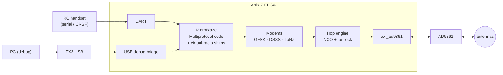

# LibreSDR MultiTX

**A multi-protocol RC transmitter that lives entirely inside an SDR's FPGA.**

LibreSDR MultiTX turns a LibreSDR B220 mini (Artix-7 XC7A200T + AD9361) into a
stand-alone RC transmitter module that speaks the radio protocols of off-the-shelf
receivers. The protocol code comes from the
[DIY Multiprotocol TX Module](https://github.com/pascallanger/DIY-Multiprotocol-TX-Module)
project and runs unmodified on a MicroBlaze soft core inside the FPGA. Only the
per-chip radio drivers are replaced. Instead of talking SPI to a CC2500, NRF24L01,
A7105, CYRF6936 or SX1276, they drive *virtual radios*: modems in FPGA fabric in
front of the AD9361. ExpressLRS support is planned on the same foundation.


> **Status:** the FPGA platform, the MicroBlaze firmware and the AD9361 driver work
> on hardware. Multiprotocol's own FrSky D8/D16 code runs on a virtual CC2500 and
> its hopping packets decode correctly off the air; testing with a real receiver
> is next. See the [roadmap](#roadmap).

## How it works



- **Virtual radios.** Multiprotocol's protocol files write raw chip registers. The
  shims decode those writes (data rate, deviation, sync word, CRC, channel) into a
  configuration for generic FPGA modems, so the protocol files stay untouched.
- **Hopping without retuning delays.** The 2.4 GHz band (83.5 MHz) is wider than
  the AD9361's 56 MHz bandwidth. It is split into 2–4 slices. A hop inside a slice is
  a digital NCO change (under 1 µs); a hop between slices recalls an AD9361
  fastlock profile (tens of µs, no calibration).
- **Full-duplex front end.** Both synthesizers stay locked (FDD mode) and TX is
  gated digitally, so the TX→RX turnaround needed for telemetry and auto-ack is
  near-instant.

More in [docs/design-notes.md](docs/design-notes.md).

## Hardware

| | |
|---|---|
| Board | LibreSDR B220 mini (USRP B210 clone), Artix-7 **XC7A200T-2 FBG484** variant |
| RF | AD9361 (CMOS dual-port interface), 70 MHz – 6 GHz, 2×2 |
| USB | Cypress FX3 running the stock Ettus B200 firmware |
| Debug | USB debug bridge (no JTAG needed), UART on accessory connector CN2 |

Board details, pinout notes and RF switch states: [docs/hardware.md](docs/hardware.md).

## Repository layout

| Path | Contents |
|---|---|
| [`hw/multitx/`](hw/multitx) | Vivado 2022.2 block design of the MultiTX platform |
| [`hw/ip/`](hw/ip) | RTL blocks: USB debug bridge, ADC capture, TCXO DAC |
| [`hw/ref_b220/`](hw/ref_b220) | the community reference design, rebuilt in Vivado 2022.2 as a baseline |
| [`tools/`](tools) | host tools: `usbdbg.py`, `ad9361_spi.py`, `selftest.py` |
| [`remote_usb/`](remote_usb) | USB/IP setup for a board attached to a different machine |
| [`docs/`](docs) | architecture, hardware, development workflow, design notes |
| [`reference/`](reference) | submodule: [f4tnk/LibreSDR_UHD_B220_Mini_FPGA](https://github.com/f4tnk/LibreSDR_UHD_B220_Mini_FPGA) at v20e |

## Quick start

```bash
git clone --recurse-submodules <this repo>
source /opt/AMD/2022.2/Vivado/2022.2/settings64.sh
vivado -mode batch -source hw/multitx/create_project.tcl -tclargs build
```

Then load the bitstream (UHD does it through the FX3) and run the self-test:

```bash
python3 tools/selftest.py
```

Prerequisites, simulation, loading and debugging: [docs/development.md](docs/development.md).
Running the board on a remote machine over USB/IP: [docs/remote-usb.md](docs/remote-usb.md).

## Documentation

| Document | |
|---|---|
| [architecture.md](docs/architecture.md) | block design, address map, register bits, USB bridge protocol |
| [hardware.md](docs/hardware.md) | the B220 mini: FPGA configuration, connectors, RF switches, clocks |
| [development.md](docs/development.md) | building, simulating, loading, verifying |
| [remote-usb.md](docs/remote-usb.md) | USB/IP + SSH tunnel setup, VM-side FPGA loading |
| [design-notes.md](docs/design-notes.md) | why the project is built the way it is |
| [multiprotocol.md](docs/multiprotocol.md) | the Multiprotocol port, the virtual CC2500, hopping, testing with a receiver |

## Roadmap

- [x] Rebuild the community B220 FPGA design reproducibly (Vivado 2022.2)
- [x] Phase 1 platform: MicroBlaze, `axi_ad9361`, USB debug bridge, RX capture
- [x] Verified on hardware: bridge, memory, registers, AD9361 SPI (ID `0x0A`)
- [x] MicroBlaze firmware: start-up, console over USB ([fw/](fw))
- [x] AD9361 driver in the firmware (UHD's, GPL-3.0), sample interface verified to 61.44 MSPS
- [x] First RF: DDS tone out of TX/RX, received on RX2 at 2.4 GHz ([results](docs/hardware.md#first-rf-test))
- [x] GFSK/FSK TX modem with channel NCO (`gfsk_tx`), FrSky D8/D16 packets decoded over the air
- [x] LO slice switching (fast synthesizer retune, ~0.3 ms; fastlock not needed so far)
- [x] Virtual CC2500 + Multiprotocol's FrSky D8/D16 code, packets verified off the air ([docs/multiprotocol.md](docs/multiprotocol.md))
- [ ] Bind and fly with a real FrSky receiver
- [ ] Handset input (Multiprotocol serial protocol from EdgeTX/OpenTX)
- [ ] GFSK receive path (telemetry, bind replies)
- [ ] A7105 shim → FlySky AFHDS / AFHDS2A
- [ ] Telemetry / receive path, bind
- [ ] NRF24L01, CYRF6936 (DSSS), SX1276 (LoRa) shims
- [ ] ExpressLRS (LoRa first, FLRC later)
- [ ] Stand-alone boot (the board has no FPGA flash; needs a small boot host)

## Acknowledgements

- [DIY Multiprotocol TX Module](https://github.com/pascallanger/DIY-Multiprotocol-TX-Module) — the protocol implementations this project builds on
- [ExpressLRS](https://github.com/ExpressLRS/ExpressLRS)
- [f4tnk/LibreSDR_UHD_B220_Mini_FPGA](https://github.com/f4tnk/LibreSDR_UHD_B220_Mini_FPGA) — the B220 FPGA design, pinout and timing constraints
- [Ettus Research UHD/FPGA](https://github.com/EttusResearch/uhd) — GPIF II slave-FIFO and FIFO code, and the AD9361 driver the firmware uses
- [Analog Devices HDL](https://github.com/analogdevicesinc/hdl) — `axi_ad9361`

## License

GPL-3.0-or-later, see [LICENSE](LICENSE). Files under `hw/ip/usb_debug_bridge/ettus/`
and `hw/ip/tcxo_dac/` are Ettus Research code under LGPL-3.0-or-later, with local
changes noted in their headers. `fw/third_party/uhd_ad9361/` is UHD's AD9361 driver
(GPL-3.0-or-later, changes listed in its README), and `fw/third_party/multiprotocol`
is a submodule of DIY Multiprotocol (GPL-3.0-or-later).

**Regulatory note:** transmitting is your responsibility. Check the rules for your
band and region, and keep power within legal limits.
