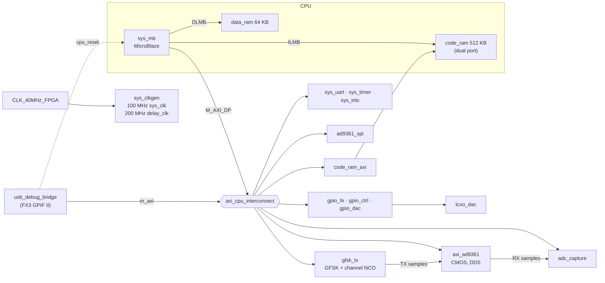

# Architecture (phase 1 platform)

The FPGA design is a Vivado 2022.2 block design, `system`, generated by
[`hw/multitx/system_bd.tcl`](../hw/multitx/system_bd.tcl). The top level
[`system_top.v`](../hw/multitx/system_top.v) only connects board pins to it. Build and
open it as described in [development.md](development.md).

## Block design



| Block | What it does |
|---|---|
| `sys_mb` | MicroBlaze, 100 MHz, barrel shifter, multiplier, divider, debug module (for a future JTAG cable) |
| `code_ram` | 512 KB. Port A: instruction LMB. Port B: AXI, used for data reads and for loading code over USB |
| `data_ram` | 64 KB on the data LMB: stack, variables |
| `usb_debug_bridge` | executes PC commands as AXI reads/writes; can hold the CPU in reset |
| `axi_ad9361` | ADI core in CMOS dual-port mode, TDD engine off, built-in DDS for test tones |
| `adc_capture` | records up to 16K I/Q samples from RX1 or RX2 |
| `gfsk_tx` | packet GFSK/FSK modulator with a channel NCO; feeds the core's TX inputs (DAC `data_sel` = 2) |
| `ad9361_spi` | AXI Quad SPI wired to the AD9361 |
| `gpio_fe` | RF switch / LED word per channel |
| `gpio_ctrl` | AD9361 RESETB, EN_AGC, SYNC, CTRL_IN, ENABLE/TXNRX request; CTRL_OUT inputs |
| `gpio_dac` → `tcxo_dac` | 40 MHz TCXO tuning word, shifted out to the DAC on change |

The MicroBlaze runs from `code_ram` (512 KB). Its instruction side uses LMB port A;
port B sits on the AXI bus, so the USB bridge can load new code while the CPU is held
in reset (bridge `ctrl_reg` bit 0). Stack and variables live in the fast `data_ram`
(64 KB, LMB only). `.data` initial values must be copied from `code_ram` at start-up.

## Address map

| Address | Size | Block | Reached by |
|---|---|---|---|
| `0x0000_0000` | 512 KB | `code_ram` (instruction LMB / AXI port) | CPU (I + D), USB |
| `0x0010_0000` | 64 KB | `data_ram` (data LMB) | CPU (D) only |
| `0x4000_0000` | 64 KB | `gpio_fe` — RF front end | CPU, USB |
| `0x4001_0000` | 64 KB | `gpio_ctrl` — AD9361 control lines | CPU, USB |
| `0x4002_0000` | 64 KB | `gpio_dac` — TCXO tuning word | CPU, USB |
| `0x4060_0000` | 64 KB | `sys_uart` — UART Lite 115200 8N1 (CN2) | CPU, USB |
| `0x4120_0000` | 64 KB | `sys_intc` | CPU, USB |
| `0x41C0_0000` | 64 KB | `sys_timer` | CPU, USB |
| `0x4400_0000` | 128 KB | `adc_capture` | CPU, USB |
| `0x4404_0000` | 64 KB | `gfsk_tx` — GFSK modulator | CPU, USB |
| `0x44A0_0000` | 64 KB | `ad9361_spi` — AXI Quad SPI (AD9361 SPI) | CPU, USB |
| `0x7902_0000` | 64 KB | `axi_ad9361` (ADI register map) | CPU, USB |

Interrupts (`sys_intc` inputs): 0 UART, 1 timer, 2 SPI, 3 `gfsk_tx` done. The
firmware enables only the timer: `sys_timer`'s timer 0 is the free-running time
base (its wrap interrupt extends it to 64 bits), timer 1 the one-shot alarm that
runs the protocol callbacks.

## GPIO bits

`gpio_fe` (channel 1 = RF channel 1, channel 2 = RF channel 2), same bits as UHD's ATR:

| bit | 7 | 6 | 5 | 4 | 3 | 2 | 1 | 0 |
|---|---|---|---|---|---|---|---|---|
| | TX_ENABLE | SFDX_RX | SFDX_TX | SRX_RX | SRX_TX | LED_RX | LED_TXRX_RX | LED_TXRX_TX |

Useful states (channel 1): `0x48` off (reset value), `0x4C` RX on the RX2 port,
`0x1A` RX on the TX/RX port, `0xE1` TX on TX/RX, `0xE5` full duplex (TX on TX/RX + RX on RX2).

`gpio_ctrl` channel 1 (outputs, reset 0): bit 0 AD9361 RESETB (0 = in reset), 1 EN_AGC,
2 SYNC_IN, 6:3 CTRL_IN[3:0], 7 ENABLE, 8 TXNRX, 9 user LED. Channel 2 (inputs): CTRL_OUT[7:0].
ENABLE/TXNRX reach the pins through `axi_ad9361` (TDD engine disabled).

`gpio_dac`: 16-bit TCXO tuning word, reset `0x7FFF` (mid-scale). A change is shifted
out to the board's DAC automatically.

## adc_capture registers (base `0x4400_0000`)

| Offset | Name | |
|---|---|---|
| `0x00` | CTRL | write bit 0 = 1 to start; bit 1 selects RX2 |
| `0x04` | STATUS | bit 0 busy, bit 1 done, [31:16] buffer size (16384) |
| `0x08` | LENGTH | samples to capture (1..16384) |
| `0x0C` | ID | `0x41444343` ("ADCC") |
| `0x10000` + 4·n | sample n | `{Q[15:0], I[15:0]}` |

## gfsk_tx registers (base `0x4404_0000`)

The CPU writes a packet as bytes (preamble, sync, payload, CRC; the modem only
shifts bits out) and the modulation as phase increments for the current sample
rate `fs`:

```
freq(t)  = CHAN_INC + DEV_INC * shape(t)         phase units per sample
shape(t) = sum over k of +-SHAPE[k][pos]         k = previous, current, next bit
out      = AMPL * exp(j * phase),  phase += freq(t)
```

| Offset | Name | |
|---|---|---|
| `0x00` | CTRL | write bit 0 = 1 to send; bit 1 = CW (unmodulated carrier at CHAN_INC) |
| `0x04` | STATUS | bit 0 busy, bit 1 done (also the interrupt), [31:16] buffer size (256 bytes) |
| `0x08` | NBITS | bits to send |
| `0x0C` | ID | `0x4746534B` ("GFSK") |
| `0x10` | BAUD_INC | symbol rate / fs · 2³² |
| `0x14` | DEV_INC | deviation / fs · 2³² (signed) |
| `0x18` | CHAN_INC | channel offset from the LO / fs · 2³² (signed) |
| `0x1C` | AMPL | [15:0] amplitude (32767 = full scale), [31:16] ramp step per sample |
| `0x20` | FLAGS | bit 0 LSB first, bit 1 invert bits |
| `0x1000` + 4·(256·k + pos) | SHAPE | frequency pulse table, Q1.15, k = 0..2 |
| `0x2000` + 4·i | PKT | packet byte i |

Settings take effect at the next packet start, or at once when idle (so CW and
the channel can be retuned live). The first symbol after start is a lead-in at
the "0" frequency while the amplitude ramps up; after the last bit the
frequency holds while it ramps down. The table and register maths are in
`fw/src/gfsk.c` and `tools/gfsk.py`, the testbench in `hw/ip/gfsk_tx/tb/`.

## USB debug bridge

The FX3 keeps running Ettus' stock B200 firmware (UHD loads it, then the bitstream).
The bridge uses the **data** endpoints: host → FPGA on bulk OUT `0x02`, FPGA → host on
bulk IN `0x86`. The control endpoints (`0x04`/`0x88`) are drained and never answered.

All traffic is in 64-bit words, each sent as two little-endian 32-bit words, high
half `[63:32]` first. Packets and responses must each stay ≤ 16 KB.

**Command packet**

| Word | `[63:32]` | `[31:0]` |
|---|---|---|
| 0 | `{4'h0, seq[11:0], packet_bytes[15:0]}` | `0x55534244` ("USBD") |
| command | `{op[7:0], flags[7:0], count[15:0]}` | address (or value) |
| write data | first 32-bit word | second 32-bit word |

| op | name | |
|---|---|---|
| `0x01` | WRITE | `count` 32-bit words follow, packed two per 64-bit word (pad an odd count) |
| `0x02` | READ | read `count` words |
| `0x03` | CTRL_WR | bridge control register = value (bit 0 = hold MicroBlaze in reset) |
| `0x04` | CTRL_RD | returns `{version, status}` |

`flags` bit 0: keep the address fixed (FIFO-style access) instead of +4 per word.

**Response packet**

| Word | `[63:32]` | `[31:0]` |
|---|---|---|
| 0 | `0x55534252` ("USBR") | `{20'h0, seq}` |
| per command | read data, two words per 64-bit word (READ / CTRL_RD only) | |
| per command | `{op \| 0x80, err[7:0], count}` | address |
| last | `0x454E4421` ("END!") | `{24'h0, OR of all err}` |

`err`: bit 0 SLVERR, bit 1 DECERR, bit 2 packet ended in the middle of a command,
bit 3 unknown op or bad magic. The FX3 path may append one padding word after the
last word; ignore anything after "END!".
