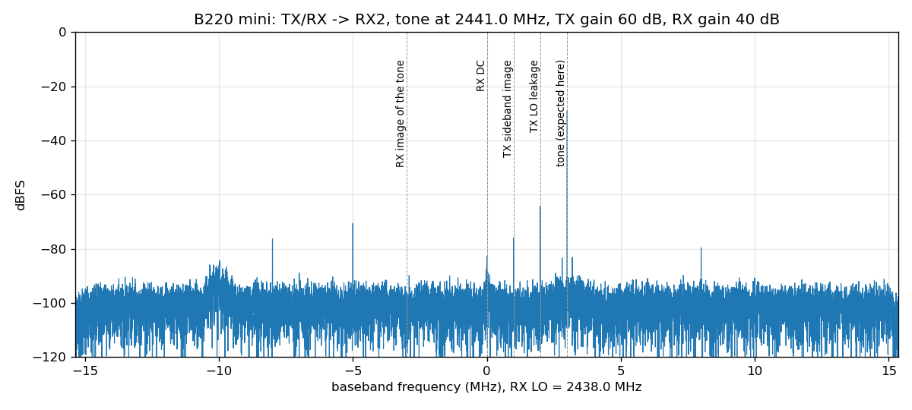

# Hardware: LibreSDR B220 mini

The B220 mini is a USRP B210 clone. Boards sold under this name come in two
variants: a Zynq-7020 one and an **Artix-7 XC7A200T + Cypress FX3** one. This project
targets the Artix-7 variant. To check which one you have: the Artix board enumerates
over USB as `2500:0020` "USRP B210" (`lsusb`), and UHD reports
`name: LibreSDR_B220mini`.

The board schematic is in [b220_mini_schematic_rev0.pdf](b220_mini_schematic_rev0.pdf),
and the community pin constraints are in [b220_reference.xdc](b220_reference.xdc).

## Main parts

| Part | Role |
|---|---|
| XC7A200T-2 FBG484 | FPGA: 134k LUTs, 365 BRAM36, 740 DSPs |
| AD9361 | RF transceiver, product ID `0x0A` (rev 2) on our board |
| CYUSB3014 (FX3) | USB 3 bridge; runs Ettus' B200 firmware, loaded by UHD at every power-up |
| 40 MHz VCTCXO | reference for the AD9361 and the FPGA (`CLK_40MHz_FPGA`, pin C18) |
| 16-bit DAC (AD5662-style) | tunes the VCTCXO (±5 ppm over the range, mid-scale = nominal) |

## FPGA configuration

- The mode pins are tied to `M[2:0] = 111` (**slave serial**). The FX3 shifts the
  bitstream in. UHD does that over USB: `uhd_usrp_probe --args fpga=<file.bin>`.
- **There is no configuration flash.** The FPGA is blank after every power cycle, so
  stand-alone operation will need a small host (for example a Pi Zero) to load it at
  boot.
- UHD stores a hash of the loaded image in the FX3 and skips reloading when the file
  content matches. `remote_usb/vm_load_fpga.sh` relies on this.

## Connectors

| Connector | What's on it |
|---|---|
| USB-C | FX3 (USB 3): power, FPGA loading, data, our debug bridge |
| CN1 (14-pin, 1.25 mm, Molex 53261-1471) | **FPGA JTAG at 1.8 V** (pins 8–11: TDO, TDI, TCK, TMS; pin 6: 1.8 V), and the FX3's own JTAG |
| CN2 (14-pin, 1.25 mm) | `FPGA_UART_TX/RX` (pins 13/14 → FPGA AA14/AB15) and `FPGA_GPIO_0..7` |
| MMCX | PPS / 10 MHz reference input |

CN2, from the schematic (`reference/schematics/miniRev0.pdf`):

| CN2 pin | Signal | FPGA | Used for |
|---|---|---|---|
| 1 | `FPGA_GPIO_0` | AA9 | **PPM input** (`ppm_in`, pulled down) |
| 2, 3, 4 | `FPGA_GPIO_1..3` | AA10, AB10, AA11 | free |
| 8, 9, 10, 11 | `FPGA_GPIO_4..7` | AB11, AB12, AA13, AB13 | free |
| 13 | `FPGA_UART_TX` | AA14 | console UART out |
| 14 | `FPGA_UART_RX` | AB15 | console UART in |
| 5, 6, 7, 12 | no net label in the schematic | | find ground with a meter before wiring |

All of these are 3.3 V LVCMOS and **not 5 V tolerant**.

The FX3 is **not** wired to the FPGA's JTAG pins. Without a JTAG cable, all debugging
goes through the USB debug bridge. A JTAG cable must support 1.8 V I/O (for example a
Xilinx Platform Cable USB II clone).

## AD9361 interface

- Data: **CMOS DDR, dual port**. P0 = RX (`CAT_P0_D[11:0]`, `CAT_RX_FR_P`,
  `CAT_DCLK_P`), P1 = TX (`CAT_P1_D[11:0]`, `CAT_TX_FR_P`, `CAT_FBCLK_P`). DATA_CLK is
  at most 61.44 MHz.
- With ADI's `axi_ad9361` core, **FB_CLK must be inverted** (DAC common register
  `0x60` = 1, done by the firmware). The core sends Q with TX_FRAME low on FB_CLK's
  rising edge and I with TX_FRAME high on the falling edge. The AD9361, set up as
  UHD does for a B210, expects I on the rising edge, as Ettus' FPGA sends it.
  Without the inversion, the AD9361 receives nothing (its digital loopback returns
  zeros). RX needs no change, and UHD's interface delays (`0x006`/`0x007` = `0x0F`)
  work up to 61.44 MSPS.
- Control: SPI (`CAT_SPI_EN/CLK/DI/DO`, mode 1), `RESETn`, `EN`, `TXnRX`, `EN_AGC`,
  `SYNC`, `CTRL_IN[3:0]`, `CTRL_OUT[7:0]`.
- I/O banks for the AD9361 and the FX3 are 1.8 V. LEDs, RF switches, UART and GPIO are
  3.3 V.

## RF front end

Only the AD9361's **A ports** (TX1A, RX1A, TX2A, RX2A) have baluns on the B220
mini; the B and C port pins are not connected. A real B210 switches between ports
A, B and C by frequency, so UHD's B210 band edges would select dead ports below
4 GHz. The firmware uses port A at every frequency, as UHD does for the B205mini.

Each channel has an 8-bit control word, in the same layout as UHD's ATR registers:

| bit | 7 | 6 | 5 | 4 | 3 | 2 | 1 | 0 |
|---|---|---|---|---|---|---|---|---|
| signal | TX_ENABLE | SFDX_RX | SFDX_TX | SRX_RX | SRX_TX | LED_RX | LED_TXRX_RX | LED_TXRX_TX |

| State | Word | Meaning | firmware |
|---|---|---|---|
| off | `0x48` | power-up default | `fe 1 off` |
| RX on RX2 port | `0x4C` | | `fe 1 rx2` |
| RX on TX/RX port | `0x1A` | | `fe 1 rx` |
| TX on TX/RX port | `0xE1` | | `fe 1 tx` |
| full duplex | `0xE5` | TX on TX/RX + RX on RX2: the mode MultiTX uses | `fe 1 fdd` |

- **AD9361 chain 1 (TX1A/RX1A) is wired to front-end word 1** (`gpio_fe` channel
  1, the `SFDX1`/`SRX1`/`tx_enable1` pins). That is the B205mini arrangement; UHD
  swaps the words on a B210 (`swap_atr`). Measured: front-end word 2 has no effect
  on chain 1.
- **The TX amplifier takes about 450 ms to reach full output after TX_ENABLE**:
  the switch adds ~6 dB at once, then nothing happens for ~270 ms, then the output
  rises another ~18 dB and settles by ~450 ms. Switching off is immediate. So
  TX_ENABLE must stay on while transmitting, and packets are gated digitally (see
  [design-notes.md](design-notes.md)).

Output power straight from the AD9361 is about +5 dBm at 2.4 GHz. Commercial RC
modules run 20–30 dBm, so useful range needs an external PA/LNA. CN2's GPIOs can
drive its T/R switch.

### First RF test

`tools/rf_tone.py` sends a DDS tone out of TX/RX and receives it on RX2 through a
cable with a 30 dB attenuator. TX LO 2440 MHz, tone +1 MHz, RX LO 2438 MHz, TX gain
60 dB, RX gain 40 dB, 30.72 MSPS:

| | 2410 MHz | 2440 MHz | 2475 MHz |
|---|---|---|---|
| tone | −28.5 dBFS | −29.0 dBFS | −29.6 dBFS |
| TX LO leakage | −35 dBc | −35 dBc | −36 dBc |
| TX sideband image | −48 dBc | −47 dBc | −48 dBc |
| RX DC | −53 dBc | −54 dBc | −50 dBc |
| RX image | −65 dBc | −67 dBc | −66 dBc |

The RX image is only that low with the AD9361's RX I/Q tracking on (register
`0x169` = `0xCF`). Calibrations switch it off, so the firmware turns it back on
after every init, rate change and retune; without it the image is about −28 dBc.
There are unexplained spurs at −5 MHz (−42 dBc) and ±8 MHz (about −50 dBc) in the
plot, still to be investigated.

## LEDs

The `LED_*_inv` LEDs are active low and follow the front-end words. The RGB LEDs are
driven off. `LED_USER_R` is `gpio_ctrl` bit 9 in our design.
