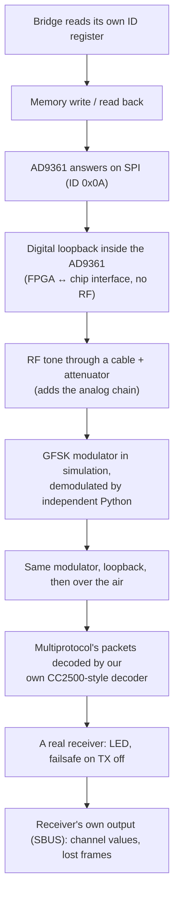

# 0. How to think about a project like this

The later chapters walk through what was done. This one collects the habits that
decided *what* to do at each point. None of them are FPGA-specific; they are how
you'd approach a BLDC driver, a robot or a compiler too. The FPGA just punishes
skipping them harder, because a mistake in hardware is quiet: there's no stack
trace, only a signal that doesn't look right.

## 1. Find the seam

A big goal ("run any RC protocol on an SDR") is only tractable if you can find a
place where the existing world can be cut and something new plugged in, without
rewriting either side.

Here the seam was Multiprotocol's chip drivers. Its protocol files (FrSky, FlySky,
…) never touch hardware directly; they call `CC2500_WriteReg`, `CC2500_Strobe`,
`A7105_WriteData` and so on, which end in `SPI_Write(byte)`. So if something
answers those SPI bytes the way a CC2500 would, the protocol code can't tell the
difference. Everything above the seam (thousands of lines of carefully tuned
protocol code) is reused as-is. Everything below it is ours.

Ask yourself: **what is the narrowest interface between the part I want to keep
and the part I want to replace?** The narrower it is, the less you have to build.

## 2. Let the hardware facts decide the architecture

Before designing anything, find out what the hardware really is. In chapter 1,
four facts from the board and its schematic changed the plan completely:

| Fact | Consequence |
|---|---|
| Artix-7, not Zynq | No ARM cores: we need a soft CPU (MicroBlaze) inside the FPGA |
| No JTAG adapter, FX3 not wired to JTAG | No Vivado debugger: we must build our own way to see inside |
| No configuration flash | The FPGA is blank at every power-up: something must load it each time |
| TX amplifier takes 450 ms to turn on (found in chapter 6) | Packets can't be switched with the amplifier: TX must stay on and be gated digitally |

Read the schematic, the datasheets, the community notes, *then* plan. An hour
there saves days of building the wrong thing.

## 3. Build the eyes before the brain

The first real thing built was not the modem or the protocol code. It was the
**USB debug bridge** (read/write anything inside the FPGA from the PC), the
**sample capture** block (an oscilloscope inside the FPGA), the **console**, and
a **self-test**. Later every feature came with its own checker
(`rf_loopback.py`, `rf_tone.py`, `gfsk_test.py`, `frsky_check.py`, the ESP32 SBUS
monitor).

If you can't observe a layer, you can't debug it, and you'll waste time guessing.
**For every block you build, decide first how you'll look at what it does.**

## 4. Start from something that works

Before designing our own FPGA image, chapter 3 rebuilt the community's design for
this board, unchanged, with our tools, and checked that it behaved exactly like
the released image. That proved the toolchain, the pin constraints and the loading
path. When something broke later, those were never suspects.

**Get a known-good baseline, then change one thing at a time.**

## 5. Climb a ladder of tests, one rung at a time

Each step was verified against something *independent* of the thing being tested,
and each rung only added one new unknown:

When a rung fails, the bug is in the one thing that rung added. The FB_CLK
inversion in chapter 5 was found in minutes because the digital loopback tests
*only* the FPGA-to-chip interface: no antenna, no amplifier, no protocol to blame.

## 6. Put the uncertain parts where they're cheap to change

Anything you're not sure about should live in software, a table or a register,
not in logic you have to rebuild:

- The GFSK pulse shape is a table the CPU loads (chapter 7), because the CC2500's
  filter parameter wasn't certain. Changing it is one line of C.
- The A7105's CRC and error-correction layout are settable at run time (chapter 9),
  because the datasheet doesn't give them. A tool learns them from a real handset.
- The packet framing is done by the CPU, not the FPGA, so one modulator serves
  every chip.

A bitstream rebuild takes 15–20 minutes; a firmware reload takes seconds.
**Decide which side of that line each uncertainty belongs on.**

## 7. Measure instead of assuming

Several plans changed because a measurement said so:

- The plan said frequency hopping would need the AD9361's *fastlock* profiles. A
  measurement showed a plain synthesizer retune relocks in about 110 µs, faster
  than a real CC2500 calibrates, so fastlock was never built (chapter 8).
- The receiver lost 2–3% of frames. Instead of guessing, a sweep of the frequency
  fine-tune found the receiver's window and its centre (chapter 10).

**Numbers end arguments.** Every result in these chapters has one.

## 8. Reuse proven code, and read its licence

The FX3 USB interface came from Ettus' code. The AD9361 driver is UHD's. The
radio core is ADI's `axi_ad9361`. The protocol code is Multiprotocol's. Writing
any of those from scratch would have taken weeks and been worse.

But check the licence before you depend on something: ADI's no-OS driver was the
obvious choice for the AD9361, yet its licence adds a condition that GPL-3.0 (the
licence of Multiprotocol, and so of this project) doesn't allow. That one fact
picked the driver (chapter 5).

## 9. Keep it reproducible

- The Vivado projects are generated from Tcl scripts, so anyone can rebuild them
  and the design is reviewable as text.
- Every meaningful step is a git commit with a message that says what was
  verified, and it is pushed so it doesn't live on one machine.
- Docs are written as things are learned, not at the end.

## 10. Budget the time-critical path

RC protocols are real-time: FrSky D16 sends a packet every 9 ms on a new channel.
For every step in that path, know how long it takes and how long you have:

| Step | Budget / cost |
|---|---|
| Packet period (FrSky D16) | 9 ms |
| Real CC2500 calibration after `STX` | ~0.8 ms |
| Our LO retune between slices | ~0.3 ms |
| Our channel change inside a slice | one register write |
| Callback lateness allowed | < 100 µs (measured worst: 18 µs) |
| TX amplifier turn-on | 450 ms: far too slow, so it stays on |

If a number doesn't fit, the architecture must change, and you want to know that
on paper, not after building it.

## A template for your own project

1. Write the goal in one sentence.
2. Find the seam: what do you keep, what do you replace, what's the interface?
3. Collect the hardware facts (schematic, datasheets, community repos). List what
   each fact forces.
4. Get access to the hardware and reproduce a known-good baseline.
5. Build your observation tools.
6. Plan the ladder of tests from "it's alive" to "it does the job", one new
   unknown per rung.
7. For each rung: build, test against something independent, commit, write down
   what you learned.
8. When a plan meets a measurement, believe the measurement.
