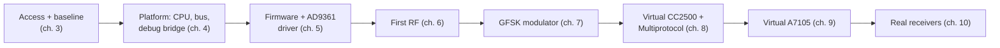

# 1. The idea and the plan

## Where we were

Nothing built yet. A LibreSDR B220 mini (a clone of Ettus' USRP B210: an FPGA
plus an Analog Devices AD9361 RF transceiver) and an idea:

> Run the [DIY Multiprotocol TX Module](https://github.com/pascallanger/DIY-Multiprotocol-TX-Module)
> code inside the SDR's FPGA, on a soft-core CPU, replacing only the parts that
> talk to radio chips. Later, add ExpressLRS.

A normal Multiprotocol module is a microcontroller (AVR or STM32) wired over SPI to
up to five radio chips: CC2500, NRF24L01, A7105, CYRF6936 and SX1276. Each RC
protocol (FrSky, FlySky, Spektrum DSM, …) is a source file that drives one of those
chips. The SDR has none of those chips, but it has something more general: a
transceiver that can produce *any* waveform from 70 MHz to 6 GHz, and an FPGA that
can compute those waveforms.

## The problem

How do you make code written for five specific chips run on a radio that is none
of them, without rewriting the protocols?

## Looking at the code first

Before deciding anything, read how a protocol file talks to its chip. In
Multiprotocol's `FrSkyD_cc2500.ino`, sending one packet is:

```c
CC2500_Strobe(CC2500_SIDLE);                                       // chip to idle
CC2500_WriteReg(CC2500_0A_CHANNR, hopping_frequency[counter % 47]); // next hop channel
CC2500_SetFreqOffset();                                            // fine tune (FSCTRL0)
CC2500_WriteReg(CC2500_23_FSCAL3, 0x89);
CC2500_Strobe(CC2500_SFRX);
FRSKYD_data_frame();                                               // build the payload
CC2500_WriteData(packet, packet[0]+1);                             // FIFO + "transmit now"
return state == FRSKY_DATA4 ? 7500 : 9000;                         // µs until the next call
```

And underneath, in `CC2500_SPI.ino`, everything is bytes on SPI:

```c
void CC2500_WriteReg(uint8_t address, uint8_t data)
{
	CC25_CSN_off;               // chip select low
	SPI_Write(address);         // register address
	NOP();
	SPI_Write(data);            // value
	CC25_CSN_on;                // chip select high
}

void CC2500_WriteData(uint8_t *dpbuffer, uint8_t len)
{
	CC2500_Strobe(CC2500_SFTX);                              // flush the TX FIFO
	CC2500_WriteRegisterMulti(CC2500_3F_TXFIFO, dpbuffer, len); // fill it
	CC2500_Strobe(CC2500_STX);                               // transmit
}
```

Notice the `return 9000` too: each protocol is a *callback* that says how many
microseconds until it wants to run again. Timing is part of the protocol.

Two important observations:

1. **Protocols never touch hardware directly.** Everything goes through
   `SPI_Write` / `SPI_Read` and the chip-select macros. That is the seam.
2. **They don't just send packets.** They write *raw register values*: the data
   rate is in `MDMCFG4/3`, the deviation in `DEVIATN`, the channel in `CHANNR`,
   the sync word in `SYNC1/0`, and they rely on the chip's own behaviour (it adds
   a preamble, a CRC, whitening; it has a FIFO; it changes state after
   transmitting).

So the replacement can't be a simple "send these bytes" function. It has to be a
**virtual chip**: a piece of software that receives the same SPI bytes a CC2500
would, keeps the same registers, and when told `STX` does what the real chip would
do, but with the SDR. Chapter 8 builds exactly that.

## Options and decisions

### Which CPU?

The B220 mini exists in two versions:

| Variant | CPU | What it would mean |
|---|---|---|
| Zynq-7020 | two ARM cores built in | run the code on an ARM core, use ADI's bare-metal driver |
| **Artix-7 XC7A200T + FX3 USB 3** | none | a *soft* CPU must be built out of FPGA logic |

The board turned out to be the Artix-7 one, so the CPU is a **MicroBlaze**:
Xilinx's soft processor, which you add to a design like any other block. At
100 MHz it is far faster than the 16 MHz AVR Multiprotocol was written for.

### How to hop frequencies?

RC protocols hop over the whole 2.4 GHz band, 2400–2483.5 MHz (FrSky uses
2404–2474 MHz). The AD9361 has one local oscillator (LO) per direction, and the
signal it sends sits within ± half the sample rate of that LO.

The original idea was to precompute an AD9361 **fastlock profile** (a saved
synthesizer setting) for every channel, store them in FPGA memory and load one
per hop. It works, but puts SPI traffic and synthesizer settling on every hop.

The plan adopted instead:

```
2403.9                 2439.1                 2474.3 MHz
  |-------- slice 0 ------|-------- slice 1 ------|
             ^ LO 2421.5             ^ LO 2456.7
  each slice: ±17.6 MHz reachable by a digital NCO (at 61.44 MSPS)
```

- Split the band into a few **slices**, each narrower than the AD9361's bandwidth.
  At 61.44 MSPS a slice is 35.2 MHz, so two slices cover FrSky.
- **Inside a slice, a hop is digital**: a numerically controlled oscillator (NCO)
  in the FPGA shifts the signal by the channel offset. Changing it is one register
  write.
- **Between slices, the LO moves.** The plan was fastlock for that; chapter 8
  measured a plain retune and found fastlock wasn't needed at all.
- Run the AD9361 in **FDD mode** (both TX and RX synthesizers always on) and
  switch the transmitter by turning the digital samples on and off. That gives a
  near-instant TX→RX turnaround for telemetry later.

The arithmetic behind "two slices": the band is 70.2 MHz wide; one slice at
61.44 MSPS can safely reach ±17.6 MHz (80% of ±22 MHz, staying inside the TX
analog filter); 70.2 / 35.2 < 2. At 30.72 MSPS it would take three or four.

### What first?

| Decision | Reason |
|---|---|
| **FrSky (CC2500) and FlySky (A7105) first** | those are the receivers available for testing; there's no point building DSM first if you can't test it |
| **Transmit only at first** | sending is the easy half; receiving (telemetry, bind replies, NRF24 auto-ack) roughly doubles the work. FrSky D8/D16 and FlySky AFHDS bind without a reply |
| **Reuse the community FPGA design as a starting point** | it already has the board's pinout, clocks and USB interface right |
| **Block design in Vivado** | the design should be readable as a diagram, not just a pile of RTL |
| **GPL-3.0** | Multiprotocol and ExpressLRS are GPL-3.0, so the combination has to be too |

### The difficulty map

| Chip | Protocols | Modem | Difficulty |
|---|---|---|---|
| CC2500 | FrSky D8/D16, SFHSS | GFSK / MSK up to 500 kbps | medium |
| A7105 | FlySky AFHDS / AFHDS2A, Hubsan | FSK / GFSK | medium |
| NRF24L01 | many toy protocols | GFSK, needs a ~130 µs auto-ack turnaround | medium, timing is the hard part |
| CYRF6936 | Spektrum DSM, Devo | DSSS with PN codes | harder |
| SX1276 | FrSky R9, ExpressLRS 900 | LoRa | hard (LoRa receive) |

Starting at the top of this table means the first protocols share one modem type
(frequency shift keying), so one FPGA modulator can serve both.

## The phases



Each phase ends in something you can test on the hardware before starting the
next. That's deliberate: never stack two untested layers.

## What it led to

Before building anything, two practical questions: how to reach a board that is
plugged into a different computer, and how to know the toolchain produces
working images for it. That's chapter 3. But first, if FPGAs are new to you,
chapter 2 explains the vocabulary.

## The thinking move

**Read the code at the boundary you want to cut, and read the hardware's
schematic, before you design anything.** The seam (SPI bytes) and the constraints
(Artix, no JTAG, no flash) were both visible in an hour of reading, and they shaped
everything after.
