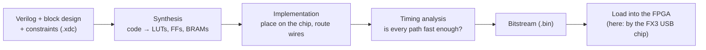

# 2. FPGA primer, using this project

This chapter is for someone who writes C for microcontrollers but has never built
anything for an FPGA. It explains only what you need to read the rest, with
examples from this repository.

## What an FPGA is

A microcontroller is a fixed circuit that *runs* your program one instruction at a
time. An FPGA is a chip full of small, unconnected logic pieces, and your "program"
(the **bitstream**) *wires them up* into a circuit. Once loaded, that circuit does
everything at once, every clock cycle, in parallel.

The pieces in our Artix-7 XC7A200T:

| Piece | What it is | How many |
|---|---|---|
| **LUT** (look-up table) | a tiny truth table: any logic function of 6 inputs | 133,800 |
| **Flip-flop** (register) | stores one bit, updates on a clock edge | 267,600 |
| **Block RAM** (BRAM) | 36 Kbit memory blocks, dual-ported | 365 |
| **DSP slice** | a hardware multiplier + adder (25×18 bit) | 740 |
| **I/O pins, clock managers (MMCM/PLL)** | talk to the board, make clocks | — |

Our whole design (CPU, bus, USB bridge, modem) uses about 10% of the LUTs and half
the block RAM (most of that is the CPU's 512 KB of memory).

## Verilog in five minutes

Verilog *describes hardware*. It looks like C, but nothing "runs in order".

### Wires and registers

```verilog
wire       a_and_b = a & b;     // a wire: always equal to a AND b, no memory

reg [7:0]  count = 0;           // a register: 8 flip-flops
always @(posedge clk)           // on every rising edge of clk...
  count <= count + 1;           // ...count takes the value count + 1
```

- `assign` / `wire` = combinational logic: the output follows the inputs (after a
  few nanoseconds of gate delay).
- `always @(posedge clk)` = sequential logic: on each clock edge, registers take
  their new values *all at the same time*. `<=` means "on the next edge". Two
  statements `a <= b; b <= a;` swap a and b, because both read the old values.

### A complete module: blink an LED

```verilog
module blink (
  input  wire clk,          // 100 MHz
  output wire led
);
  reg [26:0] counter = 0;   // 2^27 / 100 MHz = 1.34 s per wrap
  always @(posedge clk)
    counter <= counter + 1;
  assign led = counter[26]; // the top bit toggles every 0.67 s
endmodule
```

That's a whole design: a 27-bit adder and 27 flip-flops. There's no loop, no
delay function. Time is counted in clock cycles.

### `if` and `case` become multiplexers

```verilog
always @(posedge clk)
  if (start) state <= RUNNING;      // a mux in front of the state register
  else if (done) state <= IDLE;
```

Every `if` builds a selector circuit. Every variable assigned in an `always` block
becomes a register.

## Clocks, and crossing between them

Everything in a clocked design happens on clock edges. Our design has several
clocks:

| Clock | Frequency | Used by |
|---|---|---|
| `sys_clk` | 100 MHz (from the 40 MHz board oscillator) | CPU, bus, USB bridge |
| `delay_clk` | 200 MHz | the AD9361 interface's input delay calibration |
| `l_clk` | up to 61.44 MHz, from the AD9361 | sample processing: `gfsk_tx`, `adc_capture` |

The CPU writes a register at 100 MHz; the modulator reads it at 61.44 MHz.
Signals that cross from one clock to another can be caught mid-change, so they
need a **synchroniser**. This project uses the *toggle* pattern everywhere; here
it is in [`adc_capture.v`](../../hw/ip/adc_capture/adc_capture.v):

```verilog
// CPU side (s_axi_aclk): a "start" writes flip a bit
arm_tgl <= ~arm_tgl;

// sample side (adc_clk): pass it through 3 flip-flops, look for a change
(* ASYNC_REG = "TRUE" *) reg [2:0] arm_sync = 3'b000;
always @(posedge adc_clk) begin
  arm_sync <= {arm_sync[1:0], arm_tgl};     // shift in the toggle
  if (arm_sync[2] != arm_sync[1])           // it changed: one start event
    capturing <= 1'b1;
```

The first flip-flop may go "metastable" (stuck between 0 and 1 for a moment); by
the second it has settled. Comparing the last two gives exactly one event per
toggle. `ASYNC_REG` tells Vivado to place them close together. The same pattern
sends "done" back the other way.

## AXI: how a CPU talks to your blocks

Inside the FPGA, the CPU reaches peripherals over a bus called **AXI** (here the
simple version, AXI4-Lite). It's memory-mapped, like registers on a
microcontroller: the CPU writes to address `0x4404_0018` and that lands in
`gfsk_tx`'s `CHAN_INC` register.

A write is a handshake on a few signals. The master (CPU) raises `awvalid` with
the address and `wvalid` with the data; the slave (your block) answers with
`awready`/`wready` when it takes them, then `bvalid` to say "done". In
`adc_capture.v`:

```verilog
if (s_axi_awvalid && s_axi_wvalid && !s_axi_awready && !s_axi_bvalid) begin
  s_axi_awready <= 1'b1;       // took the address
  s_axi_wready  <= 1'b1;       // took the data
  s_axi_bvalid  <= 1'b1;       // response: OK
  case (s_axi_awaddr[7:2])     // which register (word address)
    6'h00: if (s_axi_wdata[0] && !busy) ... start a capture ...
    6'h02: length <= s_axi_wdata ...;
  endcase
end
```

From C, that whole handshake is one line: `*(volatile uint32_t *)0x44000008 = 4096;`.
Every custom block in this project (`adc_capture`, `gfsk_tx`) has this same
register front end and a different "engine" behind it.

## Block designs: wiring IP together

Vivado's **IP Integrator** lets you build a design as a diagram: drop in blocks
(a MicroBlaze, a UART, a GPIO, your own Verilog module), connect their ports, and
let Vivado generate the glue. This project generates its diagram from a Tcl script,
[`system_bd.tcl`](../../hw/multitx/system_bd.tcl), so it's reproducible and
reviewable. Its small helpers make it read almost like a netlist:

```tcl
add_ip sys_uart  xilinx.com:ip:axi_uartlite:2.0 {CONFIG.C_BAUDRATE 115200}  ;# a Xilinx IP
add_module gfsk_tx gfsk_tx                                                  ;# our Verilog
wire axi_ad9361/l_clk        gfsk_tx/dac_clk                                ;# a connection
wire gfsk_tx/dac_data_i      axi_ad9361/dac_data_i0
place gfsk_tx 0x44040000 64K DU                                             ;# its address
```

Open `hw/multitx/vivado/multitx.xpr` in Vivado 2022.2 and click *Open Block
Design* to see the result as a diagram.

Kinds of blocks you'll meet:

| Kind | Example here | What it gives you |
|---|---|---|
| Xilinx IP | `microblaze`, `axi_uartlite`, `axi_gpio`, `axi_quad_spi`, `clk_wiz`, `blk_mem_gen` | ready-made, configurable with `CONFIG.*` properties |
| Third-party IP | ADI's `axi_ad9361` | a complete AD9361 interface with registers and a test-tone generator |
| Module reference | `gfsk_tx`, `adc_capture`, `usb_debug_bridge` | your own Verilog file dropped into the diagram |
| Glue | `xlconstant`, `xlslice`, `xlconcat`, `util_vector_logic` | constants, bit picks, bus joins, an OR gate |

## From source to bitstream



- **Constraints** (`.xdc` files) tell Vivado which package pin each port uses and
  at what voltage ([`pins.xdc`](../../hw/multitx/pins.xdc)), and how fast each clock
  is ([`timing.xdc`](../../hw/multitx/timing.xdc)).
- **Timing**: between two flip-flops, the logic must settle within one clock
  period. Vivado reports the worst margin as **WNS** (worst negative slack). Positive
  = all paths fit. Our builds report WNS +0.75 to +1.14 ns at 100 MHz (10 ns period):
  comfortably fast enough. A negative WNS means the design may work on your desk and
  fail when warm. Never ship one.
- A full build takes 15–20 minutes. That's why things that might change often
  (firmware, tables, coding parameters) live in memory the CPU can rewrite, not in
  the bitstream.

## A soft CPU

A **MicroBlaze** is a 32-bit RISC processor built from LUTs and flip-flops. You
choose its features (hardware multiplier, divider, barrel shifter) and attach
memory:

- **LMB** (local memory bus): a direct, single-cycle path to block RAM. Our CPU
  fetches instructions from `code_ram` and keeps its stack in `data_ram` over LMB.
- **AXI**: the general bus to peripherals.

It runs C compiled with `mb-gcc`, exactly like a microcontroller, except you
decided what peripherals it has.

## Simulation

You can't put a debugger on an FPGA's internal wires easily (and we had no JTAG at
all), so you test modules in a **simulator** first. A testbench is Verilog that
drives a module's inputs and records its outputs. This project's testbenches
write outputs to a file and check them with Python
([`hw/ip/gfsk_tx/tb/check.py`](../../hw/ip/gfsk_tx/tb/check.py) demodulates the
simulated radio signal and compares the bits). Vivado's simulator is `xsim`.

## Glossary

| Term | Meaning |
|---|---|
| I/Q | a radio signal as two numbers per sample: in-phase and quadrature, the real and imaginary parts of a complex number |
| LO | local oscillator: the frequency the AD9361 mixes the signal up to or down from |
| NCO | numerically controlled oscillator: a phase counter + sine table that makes a digital tone of any frequency |
| MSPS | mega-samples per second; the sample rate sets the bandwidth (±rate/2 around the LO) |
| dBFS / dBc | level relative to digital full scale / relative to the main signal |
| GFSK | Gaussian frequency shift keying: 1 = frequency up, 0 = down, with smoothed transitions |
| FDD / TDD | both transmitter and receiver always on / taking turns |
| CDC | clock domain crossing |
| WNS | worst negative slack: timing margin of the slowest path |
