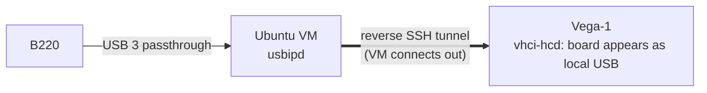

# 3. Reaching the board and a known-good baseline

## Where we were

A plan (chapter 1), a development machine with Vivado ("Vega-1"), and the SDR
plugged into a *different* computer: a Windows PC, far away. No JTAG adapter.

## Problem 1: the board is on another computer

Everything we build has to be loaded into the board and tested on it, many times a
day. The board can't come to Vivado, so the USB connection has to.

### Options

| Option | Verdict |
|---|---|
| Install Vivado next to the board | heavy, and the work lives in two places |
| JTAG over the network (Xilinx Virtual Cable) | needs a JTAG adapter, which we didn't have |
| **USB/IP**: Linux shares a USB device over TCP; another Linux machine attaches it as if it were plugged in | needs only a Linux box (or VM) next to the board |

We picked USB/IP, with an Ubuntu Server VM on the Windows PC as the "board host".

### How it was built

- [`remote_usb/vm_setup.sh`](../../remote_usb/vm_setup.sh) installs the USB/IP
  server on the VM and three services: the server, an **auto-bind** loop, and the
  **SSH tunnel**. The VM opens the tunnel *outwards* to Vega-1, so nothing on the
  home network is exposed, and the tunnel's key can only forward one port, with no
  shell.
- [`remote_usb/vega_setup.sh`](../../remote_usb/vega_setup.sh) installs the
  matching **auto-attach** service on Vega-1.

Why the auto-bind/attach loops? The B220's USB chip (a Cypress FX3) boots
empty. UHD (Ettus' driver) first uploads firmware into the FX3, and the FX3 then
*disconnects and reconnects* as a new device. A plain USB/IP share would lose it
every time. The services notice and re-share it within about two seconds.

## Problem 2: loading a bitstream through the tunnel takes forever

The first attempt to load the FPGA image from Vega-1 hadn't finished after
5 minutes.

### Finding out why

UHD sends the 5.5 MB bitstream as about 11,000 small USB *control* transfers, and
each one waits for an acknowledgement. Over USB/IP every acknowledgement is a full
network round trip, measured at 170–400 ms. 11,000 × 0.3 s ≈ 55 minutes.

Once you can name the cost (round trips × latency), the fix is obvious: don't do
that step over the network.

### The fix

[`remote_usb/vm_load_fpga.sh`](../../remote_usb/vm_load_fpga.sh) runs on the VM.
It takes the board back from the tunnel for a moment, loads the FX3 firmware and
the bitstream locally (seconds), and shares the board again.

There was a bonus: UHD stores a hash of the loaded image in the FX3, computed from
the file's contents. When Vega-1 later opens the board with the *same* file, UHD
sees the hash match and skips the reload. So both sides can use UHD normally as
long as both have identical image files.

Other things that are slow over the tunnel and fine locally: UHD's full AD9361
set-up (7 minutes, thousands of register writes), and UHD's timer self-test (it
fails, because it compares the board's clock with the PC's over a 0.3 s delay).
Neither matters, because in our own design the CPU *inside* the FPGA sets up the
AD9361. Nothing timing-critical crosses the network.

## Problem 3: which FPGA image, and does our toolchain make working ones?

The B220 is a B210 clone with a different FPGA (Artix-7 instead of Ettus'
Spartan-6), so Ettus' images don't work. The community design for it is
[f4tnk/LibreSDR_UHD_B220_Mini_FPGA](https://github.com/f4tnk/LibreSDR_UHD_B220_Mini_FPGA):
Ettus' B200 Verilog ported to the Artix-7, with this board's pinout.

Before writing a single line of our own, the plan was to **rebuild that design,
unchanged, with our tools, and check it behaves exactly like the released
image**. If it does, we know:

- the toolchain version works for this chip;
- the pin constraints are right;
- the build-load-test loop works end to end.

Then every later problem is in *our* changes, not in the foundations.

### What got in the way

- The upstream project was saved with **Vivado 2025.2**. Vega-1 had 2026.1 and
  2022.2. **2026.1 had no Artix-7 device support installed**, and 2022.2 can't
  open a project saved by a newer version.
- Choosing 2022.2 had another reason: ADI's `axi_ad9361` core, which we'd need
  later, comes from ADI's hdl release `2022_r2`, made for Vivado 2022.2.

### How it was solved

Instead of opening their project file, recreate it with a script
([`hw/ref_b220/`](../../hw/ref_b220)):

- [`create_project.tcl`](../../hw/ref_b220/create_project.tcl): makes a fresh
  2022.2 project for the `xc7a200tfbg484-2` part, adds the sources *in place*
  from the `reference/` git submodule (pinned to tag v20e, never modified), and
  uses the same synthesis/implementation strategies as upstream.
- [`sources.tcl`](../../hw/ref_b220/sources.tcl): the 106 source files, extracted
  from the upstream project file.
- [`ips.tcl`](../../hw/ref_b220/ips.tcl): the 5 IP cores (two clock wizards, two
  FIFOs, one VIO). Their saved `.xci` files from 2025.2 would be "locked" in 2022.2,
  so each core is regenerated from only the parameters the author chose. Derived
  values (like the clock dividers) are left for the wizard to compute.

### How we knew it worked

| Check | Result |
|---|---|
| Build | timing met (WNS +0.022 ns, tight but passing), no critical warnings |
| Resources | 37% LUT, 41% BRAM: lots of room left |
| On the board | `uhd_usrp_probe` output identical, line for line, to the release image's (except the tunnel-affected timer test) |
| Right image really loaded | UHD printed no "Loading FPGA image": the hash matched our file |

The vendor's design also contains an AES/DNA "copy protection" check. Reading it
showed it only drives an LED, so it could be ignored.

## What it led to

A trusted loop: **script → Vivado 2022.2 → bitstream → load on the VM → test
from Vega-1**. And a reference to copy from: the B220's pinout, clock set-up and
Ettus' FX3 interface code, all proven on this board. Next: our own design.

## The thinking move

**Reproduce before you modify.** A rebuild of a known-good design is boring and
quick, and it takes the toolchain, the pinout and the loading path off the suspect
list for the rest of the project. And when something is slow, **count the round
trips**: the fix for the tunnel was obvious once the cost was written as
"11,000 × 0.3 s".
