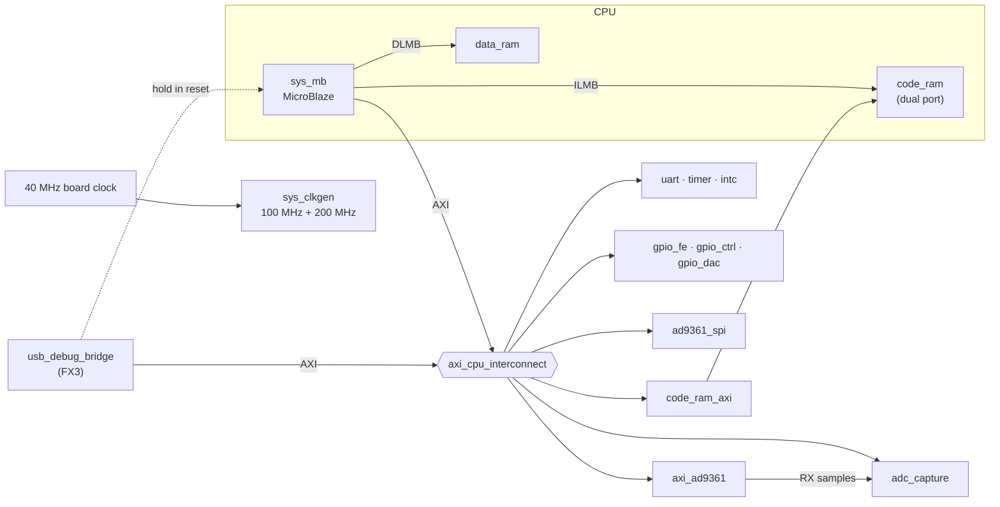

# 4. Our own platform: CPU, buses and a way to see inside

## Where we were

A trusted build-and-load loop and a working reference design (chapter 3). Nothing
of our own on the FPGA yet.

## The problem

We need a design that will eventually run Multiprotocol's code and drive the
AD9361. Before any of that can be debugged, we need to answer: **with no JTAG
cable, how do we see what's happening inside the FPGA?**

Normally you'd use Vivado's hardware manager over JTAG: the MicroBlaze debugger
(breakpoints, memory view) and the ILA (a logic analyser built into the FPGA).
The B220's JTAG pins go only to a 1.8 V header, and the FX3 USB chip isn't wired
to them. So none of that was available.

## The decision: build the platform around our own debug path

The FX3 *is* connected to the FPGA, by a 32-bit parallel bus (Cypress calls it
GPIF II), and it already runs Ettus' firmware that turns USB endpoints into FIFOs
on that bus. That's how UHD streams samples. So:

> Put an **AXI master** behind the FX3's data FIFOs. The PC sends "write these
> words at this address" / "read N words from that address" packets; the FPGA
> executes them on the same bus the CPU uses.

With that one block, the PC can read and write *every* register and memory in the
design, hold the CPU in reset, load its program, and read captured radio samples.
It replaces the debugger and the ILA.

## The block design



The whole thing is generated by [`system_bd.tcl`](../../hw/multitx/system_bd.tcl).
Here is each block and the reason it's there.

### `sys_mb`: the CPU

A MicroBlaze at 100 MHz with a barrel shifter, hardware multiplier and divider
(the protocol code does plenty of shifts and multiplies). Its debug module is
included anyway, for the day a JTAG cable arrives.

### `code_ram`: memory the PC can rewrite

```tcl
add_ip code_ram   xilinx.com:ip:blk_mem_gen:8.4 {
  CONFIG.Memory_Type True_Dual_Port_RAM
  CONFIG.use_bram_block BRAM_Controller
}
# port A = instruction LMB (the CPU fetches code), port B = AXI (data reads + loading)
connect_bd_intf_net [get_bd_intf_pins ilmb_cntlr/BRAM_PORT] [get_bd_intf_pins code_ram/BRAM_PORTA]
connect_bd_intf_net [get_bd_intf_pins code_ram_axi/BRAM_PORTA] [get_bd_intf_pins code_ram/BRAM_PORTB]
```

Block RAM has two independent ports. Port A feeds the CPU's instruction fetch;
port B is on the AXI bus, so **the USB bridge can write a new program into it**.
That's the key to a fast firmware loop: hold the CPU in reset, write the program,
release. No bitstream rebuild (15–20 minutes) for a firmware change. It started at
256 KB and was doubled to 512 KB in chapter 8.

### `data_ram`: fast and private

64 KB on the CPU's data LMB only: stack, variables, heap. Single-cycle, and the PC
can't see it. That last point matters later: anything the PC must read (like the
console) has to live in `code_ram`.

### The reset OR gate

```tcl
add_ip sys_mb_reset xilinx.com:ip:util_vector_logic:2.0 {CONFIG.C_OPERATION or CONFIG.C_SIZE 1}
wire sys_rstgen/mb_reset sys_mb_reset/Op1         ;# power-on reset
wire usb_debug_bridge/cpu_reset sys_mb_reset/Op2  ;# "hold" from the PC
wire sys_mb_reset/Res    sys_mb/Reset
```

One gate: the CPU is in reset if the board is starting up *or* the PC asks for it
(bridge control register, bit 0).

### `usb_debug_bridge`: the eyes

Three layers ([`hw/ip/usb_debug_bridge/`](../../hw/ip/usb_debug_bridge)):

1. **Ettus' GPIF II slave FIFO** (`ettus/gpif2_slave_fifo32.v` and friends):
   speaks the FX3's bus protocol and turns it into streams of 64-bit words, one for
   each USB endpoint. Reused, because it's proven with this exact FX3 firmware.
2. **`usb_cmd_proc.v`** (ours): a state machine that reads a command packet from
   the stream and executes it on AXI. Its states read like the protocol:
   `S_HDR` (packet header) → `S_CMD` (next command) → `S_WR_DATA`/`S_WR_ISSUE`/
   `S_WR_WAIT` or `S_RD_ISSUE`/`S_RD_WAIT` → `S_STATUS` (report) → `S_END`.
3. **`usb_debug_bridge.v`**: wires the two together, synchronises the FX3's reset,
   and forwards the 100 MHz clock to the FX3 through an `ODDR` (the standard way
   to output a clock cleanly from an FPGA).

The packet format is in [architecture.md](../architecture.md#usb-debug-bridge).
In short: a header with a magic word (`"USBD"`) and a sequence number; then
commands `{op, flags, count, address}` with data; the response echoes the
sequence number and ends with `"END!"` and an error summary. Every response
carries a status per command, so a read from an unmapped address returns an
error flag instead of hanging the PC.

**The problem met here:** Ettus' FIFO code used a vendor FIFO IP core and a
"macro include" trick to pick RAM types. Vivado's block-design flow can't use a
module that depends on those. The fix was to replace their dual-clock FIFO with
Xilinx's XPM FIFO macro ([`axi_fifo_2clk_xpm.v`](../../hw/ip/usb_debug_bridge/axi_fifo_2clk_xpm.v))
and their RAM wrapper with a plain inferred RAM, with the changes noted in each
file's header (they're LGPL).

**How it was tested before touching hardware:**

- A Verilog testbench (`tb/tb_usb_cmd_proc.v`) checks writes, reads, odd word
  counts, error reporting and malformed packets.
- A co-simulation (`tools/test_usbdbg_cosim.py`) runs the *real PC tool's*
  packets through the RTL in the simulator. If the Python side and the Verilog
  side disagree on the format by one bit, this catches it, not the board.

The PC side is [`tools/usbdbg.py`](../../tools/usbdbg.py), using `pyusb`:

```bash
python3 tools/usbdbg.py read 0x79020000        # one register
python3 tools/usbdbg.py load fw.bin            # hold CPU, write code_ram, verify, run
python3 tools/usbdbg.py console                # the firmware's console (chapter 5)
```

### `adc_capture`: an oscilloscope inside the FPGA

Without an ILA, we still need to see radio samples. `adc_capture` records up to
16,384 I/Q samples from either receive channel into block RAM, then the PC reads
them over the bridge. It's small and shows the pattern every custom block here
follows:

- **AXI-Lite registers** on the bus clock (CTRL, STATUS, LENGTH, ID).
- **An engine** on the sample clock (`adc_clk`, from the AD9361).
- **Toggle synchronisers** between the two (see chapter 2).
- **An ID register** (`"ADCC"`): the first test of any block is "can I read my
  own ID?", which proves the address map, the bus and the bitstream in one read.

### `axi_ad9361`: the radio interface

ADI's core, configured for this board: CMOS dual-port data interface
(`CMOS_OR_LVDS_N 1`), TDD engine off (we'll run FDD), and its built-in DDS
test-tone generator kept for the first RF test. It handles the hard part (the
double-data-rate sample bus to the AD9361, with input delay calibration on the
200 MHz `delay_clk`) and gives us plain I/Q samples and registers.

### The GPIOs: three small, honest blocks

| Block | Bits | Why its own block |
|---|---|---|
| `gpio_fe` | RF switch + LED word per channel, same bit layout as UHD's | reset value `0x48` = "everything off", so the board powers up silent |
| `gpio_ctrl` | AD9361 RESETB, EN_AGC, SYNC, CTRL_IN, ENABLE/TXNRX; CTRL_OUT in | reset value 0 holds the AD9361 in reset until the firmware is ready |
| `gpio_dac` → `tcxo_dac` | 16-bit tuning word for the 40 MHz reference oscillator | reset `0x7FFF` = mid-scale = nominal frequency; a change is shifted out to the DAC automatically (Ettus' small SPI module) |

Choosing **safe reset values** in hardware means nothing dangerous happens before
the firmware runs: no transmitter on, no AD9361 running with random settings.

### The address map

```tcl
place code_ram_axi 0x00000000 512K DU     ;# D = CPU data side, U = USB bridge
place gpio_fe      0x40000000 64K  DU
place adc_capture  0x44000000 128K DU
place axi_ad9361   0x79020000 64K  DU
```

Every slave gets **the same address for the CPU and the USB bridge**, so a
register address in the docs works from C, from Python and from the console. The
full table is in [architecture.md](../architecture.md#address-map).

## How we knew it worked

| Check | Result |
|---|---|
| Build | timing met, WNS +1.14 ns; 9% LUT, 34% BRAM |
| Bridge responds | version `0x00010000`, `adc_capture` ID reads `ADCC` |
| `code_ram` 256 KB random data written and read back | 0 mismatches (~15 s each way over the tunnel) |
| Unmapped address | returns an error flag, no hang |
| GPIO reset values | front end `0x48`, AD9361 held in reset, DAC `0x7FFF` |
| `axi_ad9361` core | version registers readable, scratch register holds a value |
| **AD9361 over SPI** | out of reset, product ID **`0x0A`** |

All of it became one command, [`tools/selftest.py`](../../tools/selftest.py):
8/8 pass. It's the first thing to run after loading any bitstream.

## What it led to

A design that can see itself. The CPU still has no program, though. Next: firmware
for a processor with no operating system, no vendor libraries and no debugger.

## The thinking move

**Build the observation path first, and make it general.** One AXI master behind
USB gave access to everything that was built afterwards, including blocks that
didn't exist yet. And give every block an ID register and safe reset values: the
first test of anything new is a single read, and nothing misbehaves before
software is ready.
