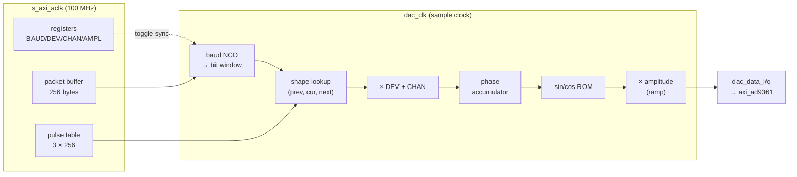

# 7. A GFSK modulator in Verilog

## Where we were

A trusted RF chain and a tool that captures and analyses what we send (chapter 6).
The only signal so far was a test tone.

## The problem

FrSky (CC2500) and FlySky (A7105) send packets with **GFSK**: each bit shifts the
carrier up (1) or down (0) by a fixed *deviation*, and a Gaussian filter smooths
the change so the signal doesn't splatter into neighbouring channels. We need an
FPGA block that turns a packet of bits into those I/Q samples, at a chosen
channel offset from the LO, at up to 61.44 million samples per second.

Numbers to aim at (from Multiprotocol's own CC2500 register values):

| Protocol | Bit rate | Deviation |
|---|---|---|
| FrSky D8 | 31.04 kbaud | ±31.7 kHz |
| FrSky D16 | 70.02 kbaud | ±57.1 kHz |

## Decisions before writing Verilog

**What does the FPGA do, and what does the CPU do?** A CC2500 adds a preamble, a
sync word, a CRC and whitening; an A7105 adds an ID code and error correction; an
NRF24 has its own framing again. If the FPGA did framing, it would need one
framer per chip. Instead:

> The **CPU builds the complete packet as bytes** (preamble, sync, payload, CRC,
> whatever the chip would add). The **FPGA only turns bits into a waveform.**

One modulator then serves every chip, and framing bugs are fixed in C, in
seconds.

**What must be in hardware?** Anything per-sample: at 61.44 MSPS there are 16 ns
per sample, far too fast for a CPU. So the bit clock, the frequency shaping, the
phase accumulation and the sine lookup are hardware.

**What should stay flexible?** The Gaussian filter's exact shape (its "BT"
parameter) wasn't certain for the CC2500, and differs per chip. So the pulse
shape is a **table the CPU loads**, not logic.

## The maths, in four lines

```
freq(t)  = CHAN_INC + DEV_INC * shape(t)      how far from the LO, right now
phase   += freq(t)                            every sample
I, Q     = AMPL * cos(phase), AMPL * sin(phase)
shape(t) = sum of the pulses of the previous, current and next bit (±1 each)
```

Frequencies are stored as **phase increments**: how much the phase advances per
sample, with a full circle = 2³². At 61.44 MSPS:

| Quantity | Value | Register value = f / fs × 2³² |
|---|---|---|
| D16 bit rate | 70,022 Hz | `BAUD_INC` = 4,894,893 |
| D16 deviation | 57,129 Hz | `DEV_INC` = 3,993,607 |
| channel offset +5 MHz | 5,000,000 Hz | `CHAN_INC` = 349,525,333 |

The resolution is fs / 2³² = 0.014 Hz. A 32-bit register that wraps around
naturally *is* a circle: that's why NCOs use powers of two.

## The block, piece by piece

[`hw/ip/gfsk_tx/gfsk_tx.v`](../../hw/ip/gfsk_tx/gfsk_tx.v), about 330 lines. It
has the same two halves as `adc_capture` (chapter 4): AXI registers on the
100 MHz bus clock, and an engine on the AD9361's sample clock.



### The bit clock: another NCO

```verilog
baud_acc <= {1'b0, baud_acc[31:0]} + r_baud;   // 33-bit: bit 32 = overflow
if (baud_acc[32] && state != S_IDLE) begin     // overflow = a symbol boundary
  b_prev <= b_cur;                             // slide the 3-bit window
  b_cur  <= b_next;
  if (have_bit) begin
    b_next  <= raw_bit;                        // fetch the next bit from the buffer
    bit_idx <= bit_idx + 1'b1;
  end
end
```

Adding `BAUD_INC` every sample makes the accumulator overflow exactly
`bit rate` times per second, on average, for any rate, without a divider. Its top
8 bits (`baud_acc[31:24]`) say *where inside the current bit* we are (0–255): the
index into the pulse table.

### The Gaussian pulse: three table lookups

A Gaussian-filtered bit lasts longer than one bit period: it starts rising during
the previous bit and is still fading during the next. So at any moment the
frequency depends on three bits. The table holds, for each position inside a bit,
the contribution of the previous, current and next bit:

```verilog
shape <= (b_prev ? shape0[pos] : -shape0[pos])   // tail of the previous bit
       + (b_cur  ? shape1[pos] : -shape1[pos])   // this bit
       + (b_next ? shape2[pos] : -shape2[pos]);  // head of the next bit
```

The CPU computes the table from the Gaussian formula
([`fw/src/gfsk.c`](../../fw/src/gfsk.c), `gfsk_precompute()`): an `erf()` pulse,
normalised so a long run of ones gives exactly +1.0. For plain FSK it's a step.
Each entry is Q1.15 fixed point (a signed 16-bit number where 32767 means 1.0).

### Frequency, phase, sine: a pipeline

```verilog
// stage 2: frequency word, stage 3: phase
fdev  <= r_dev * shape;                                   // a DSP multiplier
phase <= phase + r_chan + (modulate ? fdev[46:15] : 0);   // Q1.15 → integer

// stage 4: sine/cosine, stage 5: amplitude
sc     <= sincos[phase[31:20]];                           // 4096-entry ROM, top 12 bits
i_prod <= $signed(sc[15:0])  * $signed({1'b0, ampl_d2[14:0]});
dac_data_i <= i_prod[30:15];
```

Each line is one register stage. At every clock, each stage works on a different
sample: that's a **pipeline**. Splitting the work into short steps is how a design
runs at 61.44 MHz: no single path has to do a multiply *and* an add *and* a memory
read within 16 ns. The cost is a few samples of delay, which nobody can notice.

Note how a multiply is just `*`: Vivado maps it onto a DSP slice. The block uses
4 DSPs, 4 block RAMs and about 500 LUTs.

### Ramps: not splattering the band

Switching a carrier on instantly produces a click of wide-band energy. The
`AMPL` register has a ramp step: the amplitude climbs to full over the first
symbol (a "lead-in" at the frequency of a 0 bit), and falls after the last bit. That's
what a real chip's power amplifier ramping does too.

### Configuration across clocks

The CPU writes `BAUD_INC`, `CHAN_INC` and friends at 100 MHz; the engine uses them
at the sample clock. A write flips a toggle (`cfg_tgl`), the engine sees it
through a synchroniser and copies all the registers at once into its own `r_*`
copies, either when idle or at the start of a packet. A packet never sees half a
configuration. A channel change is one write of `CHAN_INC`.

## How we knew it worked

Three rungs, each adding one unknown:

**1. Simulation, checked by independent code.** The testbench
([`tb/tb_gfsk_tx.v`](../../hw/ip/gfsk_tx/tb/tb_gfsk_tx.v)) loads registers, the
table and a packet, and writes every output sample to a file.
[`tb/check.py`](../../hw/ip/gfsk_tx/tb/check.py) then *demodulates* those samples
in Python ([`tools/gfsk.py`](../../tools/gfsk.py)): measure the instantaneous
frequency, slice it into bits, compare with what was sent. The demodulator shares
no code with the modulator, so a misunderstanding in one doesn't hide in the
other. Result: FrSky D8- and D16-style packets, two pulse shapes and plain FSK, at
4 and 30.72 MSPS: 4/4, 0 bit errors, deviation within 0.2%.

**2. The AD9361's digital loopback** (no RF): D16 5/5 and D8 3/3 packets, 0
errors, deviation within 0.3%, level exactly −6 dBFS.

**3. Over the air** (TX/RX → 30 dB attenuator → RX2):
[`tools/gfsk_test.py --mode rf`](../../tools/gfsk_test.py): D16 5/5, D8 3/3 at
channel offsets from −700 to +600 kHz, 0 errors.

The firmware side ([`gfsk.c`](../../fw/src/gfsk.c)) also learned to convert CC2500
register values into rate and deviation. `gfsk cc2500 d16` on the console
reproduces exactly the figures in the table at the top.

## What it led to

We can send any FSK/GFSK packet at any channel inside the current LO's reach. What's
missing to run real protocol code: something that turns Multiprotocol's CC2500
register writes into calls to this modulator, and a way to cover the whole band.

## The thinking move

**Split the work by speed.** Per-sample work (16 ns per sample) goes in hardware;
per-packet work (milliseconds) goes in software; things you're unsure of go in
tables the software loads. And **check a modulator with an independent
demodulator**: if you test code with its own assumptions, it will always pass.
