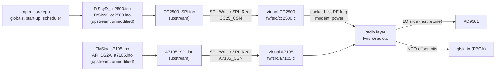

# Multiprotocol on MultiTX

The firmware runs [DIY Multiprotocol](https://github.com/pascallanger/DIY-Multiprotocol-TX-Module)'s
protocol code unmodified, against virtual radio chips. So far that's FrSky D8 and
FrSky X (D16) on a virtual CC2500, and FlySky (AFHDS) and AFHDS2A on a virtual A7105.



## Pieces

| Part | Where | |
|---|---|---|
| Multiprotocol sources | [`fw/third_party/multiprotocol`](../fw/third_party/multiprotocol) | git submodule, pinned; not modified |
| Arduino shim | [`fw/src/mpm/mpm_arduino.h`](../fw/src/mpm/mpm_arduino.h) | `millis`/`micros`/delays, `PROGMEM`, `random`, EEPROM in RAM, `SPI_Write`/`SPI_Read`, chip selects |
| Core | [`fw/src/mpm/mpm_core.cpp`](../fw/src/mpm/mpm_core.cpp) | one translation unit that `#include`s the protocol files; replaces `Multiprotocol.ino` (globals, protocol start-up, ID helpers, a µs scheduler) |
| Virtual CC2500 | [`fw/src/cc2500.c`](../fw/src/cc2500.c) | byte-level SPI slave: registers, strobes, status registers, PATABLE, TX FIFO; builds the on-air packet on `STX` |
| Virtual A7105 | [`fw/src/a7105.c`](../fw/src/a7105.c) | the same for the A7105: strobes, registers, FIFO and ID access; builds the packet on the TX strobe; an RX FIFO filled from the console |
| Radio layer | [`fw/src/radio.c`](../fw/src/radio.c) | LO slices, NCO offset, modem cache, power, front end |

`Multiprotocol.ino` isn't compiled because it is tied to AVR/STM32 timers, USARTs
and PPM input. `mpm_core.cpp` provides what the protocol files need from it.

### Virtual CC2500

What the chip would do on `STX`, the virtual one does too:

- **Packet assembly:** preamble length from MDMCFG1, sync word per SYNC_MODE (sent twice for the 30/32 modes), fixed/variable/infinite length, CRC-16 (polynomial 0x8005, init 0xFFFF), PN9 whitening.
- **Modem and RF settings:**
  - frequency = FREQ + CHANNR × channel spacing + FSCTRL0 offset;
  - data rate from MDMCFG4/3, deviation from DEVIATN;
  - modulation 2-FSK, GFSK or MSK;
  - power from PATABLE[0], mapped with the data sheet's PA table.
- **After transmitting:** the state follows MCSM1.TXOFF_MODE.
- **Not emulated:**
  - The receiver: RXBYTES stays 0 and RSSI reads −100 dBm, so there's no telemetry yet.
  - OOK, Manchester coding and FEC.
  - Calibration: `SCAL` is accepted, because the AD9361 driver calibrates the real synthesizer.
- **GFSK pulse shape:** BT = 1 is assumed (the data sheet doesn't give it).

### Virtual A7105

Both chips share the SPI bus, each with its own chip select, as on a
Multiprotocol module. On the TX strobe the virtual A7105:

- **Builds the packet:** preamble (1–4 bytes), ID code (2 or 4 bytes), payload
  (FEP + 1 bytes), CRC-16, (7,4) Hamming FEC and PN7 whitening, as enabled in
  code register I (1Fh).
- **Takes the RF settings from the registers:** frequency from the LO base,
  channel number and channel step; data rate from the clock and data rate
  registers; deviation from TX I/II; Gaussian filter BT 0.7; power from TX test
  (28h), mapped with Multiprotocol's power table.
- **Doesn't emulate the receiver.** In RX the chip waits until a packet is
  queued from the console (`a7105 rx HEX`); it then lands in the RX FIFO with a
  good CRC. `tools/afhds2a_bind.py` uses this to pass a receiver's bind reply in.

**One unknown: the coding.** The A7105 data sheet (v1.4) doesn't give the CRC-16
initial value or reflection, nor the bit layout of the Hamming code words.
AFHDS2A uses both, AFHDS the CRC. So they are settable and, until learned from a
real FlySky transmitter, default to a guess: CRC-16/CCITT-FALSE (0x1021, init
0xFFFF) and the textbook Hamming(7,4) layout.

```
a7105 coding                         # show the current coding
a7105 crc POLY INIT [REFLECT [XOROUT]]
a7105 fec WORDS16HEX [lowfirst|highfirst]
a7105 fec default                    # back to the guess
```

The coding lives in RAM, so a firmware reload resets it to the default.
`tools/a7105_sniff.py` works it out from a handset (see the home steps below).
Once it's known, it becomes the default in `a7105_coding_default()`.

### Frequency hopping

The radio runs at 61.44 MSPS. The NCO in `gfsk_tx` reaches ±17.6 MHz from the LO,
so the LO only moves when a channel falls outside the current 35.2 MHz slice. The
slice grid starts at 2403.9 MHz, so two slices cover FrSky's 2404–2474.2 MHz.

- **Slice change:** a synthesizer-only retune (`rf_fast_tune`, same registers as UHD's tune), done in the FDD state with the lock bit polled. The PLL relocks in about 110 µs, and a whole retune takes about 0.3 ms. A real CC2500 spends about 0.8 ms calibrating after `STX`.
- **Channel change inside a slice:** one NCO register write.

No AD9361 fastlock profiles are needed for this.

### Timing

The protocol callbacks run from a timer interrupt (`sys_timer`'s timer 1 as a
one-shot alarm), so the shell and the console can't delay them. Each callback
returns the delay to the next one, counted from the previous deadline (like
Multiprotocol's `OCR1A += next_callback`), so timing doesn't drift.
`tools/sched_check.py` loads the console while FrSky X runs: no callback more than
100 µs late, worst 2 µs, also while the console output ring is full (the main-loop
scheduler before it got 58.8 ms there).

Shell commands pause the protocol (interrupts off) unless they're marked live in
the command table: `help`, `info`, `md`, the `cc2500`/`a7105` displays,
`mpm status`, `mpm ch`, `mpm option`, `mpm hops`. Everything that touches the
radio or changes the protocol (`mpm start`, `rf`, `ad`, `a7105 rx`, ...) runs with
the protocol paused. Nothing in the protocol path may print.

`mpm status` also shows how late the first callback was and how long the longest
one took. A callback must stay well under the protocol's packet period, so
nothing slow may happen inside one: the GFSK pulse tables for all three BTs the
chips use are computed in `radio_start`, and every LO change is a fast retune
(0.3 ms). Longest callback today: 1.2–1.8 ms.

## Checked without a receiver

`tools/frsky_check.py` runs a protocol, captures single packets on RX2 (TX/RX →
cable + 30 dB attenuator → RX2) and decodes them like a CC2500. For each packet it
checks four things:

- the carrier offset;
- the sync word;
- the CRC: the CC2500 CRC for D8, FrSky's own for D16;
- the channel, which must be in the protocol's hop table.

To fit a packet into one capture it runs at 2–3 MSPS, where the slices are only
1.6–2.4 MHz wide and the LO retunes on nearly every hop.

| Mode | Result |
|---|---|
| FrSky D16, normal | 15/15 packets: CRC ok, channel in hop table, offset exact |
| FrSky D8, normal | 15/15 |
| FrSky D16 / D8, bind | 4/4 each (channel 0, bind packets) |

`tools/flysky_check.py` does the same for the A7105 protocols, decoding with the
coding the firmware is using (read with `a7105 coding`). So it proves the packets
match that coding, not that the coding matches the real chip.

| Mode | Result |
|---|---|
| FlySky (AFHDS), normal | 8/8: CRC ok, channel in hop table, TX ID and channel values as expected |
| AFHDS2A, normal | 8/8 |
| AFHDS2A, bind | 4/4 |

Two more checks for the A7105 tools, both without a handset:

- **Coding sniffer:** the virtual chip was given a hidden coding (another Hamming
  layout, low nibble first, CRC 0x8005 / init 0x1D0F, reflected). `a7105_sniff.py`
  recovered it exactly: the FEC and CRC from 12 AFHDS2A bind packets, and the
  AFHDS CRC from 9 packets at different stick positions.
- **AFHDS2A bind path:** a made-up receiver reply queued with `a7105 rx` completed
  the bind, and the data packets then carried that RX ID. The reply decoder in
  `afhds2a_bind.py` works on a synthetic capture, and with no receiver it times
  out cleanly.

## Handset input from the PC

The PC can drive the board the way EdgeTX drives a Multi module: with
Multiprotocol serial frames (protocol, sub-protocol, RX number, option,
bind / range / power flags, 16 channels of 11 bits; the "MULTI protocol serial
definition" in `Multiprotocol.h`). `tools/multi_link.py` writes them into a ring in
the firmware's mailbox over USB, one bridge transaction per frame:

```bash
python3 tools/multi_link.py frskyx --option -40 --ch 1=1600us 2=-50% 5=100%
python3 tools/multi_link.py frskyx --bind --seconds 10     # bind, then run without --bind
```

With a gamepad on the PC (`pip install pygame`; Xbox, PlayStation, Switch Pro and
most clones get standard input names on Linux, macOS and Windows):

```bash
python3 tools/gamepad.py                               # see the pad's input names
python3 tools/multi_link.py frskyx --gamepad --expo 0.3
python3 tools/multi_link.py frskyx --gamepad --map "1=rightx 2=-righty 3=-lefty 4=leftx 5=leftshoulder:toggle"
```

The default mapping is mode 2 in Multiprotocol's AETR order (right stick
aileron/elevator, left stick throttle/rudder), A/B/X/Y as latching switches on
channels 5–8 and the triggers on 9–10; holding Back sets the bind flag. As with a
radio's throttle warning, nothing is sent until the throttle stick is low, and if
the pad disconnects `multi_link.py` stops sending, so the protocol pauses and the
receiver goes to failsafe. Toggles count the pad's button-press events, so a tap
shorter than the frame interval isn't lost. Checked with a virtual Xbox 360 pad
(Linux uinput) holding known positions: all 8 channels read back exactly in
`mpm status`, and unplugging it stopped the frames.

The firmware parses them with code ported from Multiprotocol's
`update_serial_data()` (fw/src/input.c, `mpm_serial_frame` in mpm_core.cpp), so the
rules are Multiprotocol's: a new protocol / sub-protocol / RX number restarts the
protocol, setting the bind flag restarts it in bind mode and clearing it ends bind,
and the option, power and range flags and the channels apply to the next packet.
Like Multiprotocol, the protocol pauses when no frame arrives for 70 ms (the
receiver goes to failsafe) and resumes with the next frame. While frames arrive
they are in control; `mpm start` / `mpm stop` on the console take control back.

Over the USB/IP tunnel a frame takes a few hundred ms, so set a longer timeout
there (`--timeout 3000`). `tools/input_check.py --timeout 3000` checked it on the
board that way, 8/8: protocol start from a frame, 16 exact channel values, bind
on/off, pause on link loss (callbacks stop) and resume, a switch to AFHDS2A, and
the console taking control back. Streaming frames made no callback late (worst
2 µs).

Not yet: failsafe frames (Multiprotocol's `FAILSAFE_ENABLE` isn't built in, so
they are skipped), telemetry back to the PC, and serial frames on CN2's UART.

## Handset input from a radio (PPM)

A radio's trainer port (PPM out) on **CN2 pin 1** (`FPGA_GPIO_0`, 3.3 V) drives
the channels, as on a Multiprotocol module in PPM mode: the protocol is chosen on
the console and the radio moves the sticks.

```
mtx> input ppm                 # channels from PPM (rising edges; "input ppm falling" for inverted PPM)
mtx> mpm start frskyx          # the protocol, from the console
mtx> ppm                       # what the decoder sees: frames, channel widths in us
mtx> input range 1000 2000     # the radio's -100%/+100% widths (default 988 2012, Multiprotocol's TX_ER9X)
mtx> input console             # back to console channels
```

`hw/ip/ppm_in` applies Multiprotocol's own rules: an interval under 800 us spoils
the frame, one over 2200 us is the sync, a frame needs 4 to 16 channels. The
firmware maps the widths with Multiprotocol's `map16b` arithmetic. Without frames
for the input timeout (70 ms) the protocol pauses (receiver failsafe) and resumes
with the next frame.

**Wiring:** the trainer port's signal to CN2 pin 1 through a 1 kΩ series
resistor, and its ground to the board's ground. The FPGA pin is 3.3 V only: check
the radio's PPM level first and use a divider (for example 1 kΩ / 2 kΩ) if it is
higher.

`ppm_in` has a built-in PPM generator that can replace the pin, so the whole path
is checked without a radio: `ppm test 1000 1500 2000 ...` sets its channel widths,
`ppm test off` returns to the pin. `tools/ppm_check.py` uses it. (Status: the
testbench passes 11/11 and `ppm_check.py` 6/6 on the board; a real radio is
still to do.)

## Testing with a FrSky receiver

Channels can be set from the console (below) or from the PC with
`multi_link.py` (above).

1. Connect antennas to TX/RX (channel 1) and to the receiver. Bind power is
   −30 dBm, as on a real Multiprotocol module, so keep them within a metre or so.
2. Load the bitstream and firmware, then start the protocol in bind mode:
   ```
   mpm start frskyd 0 0 0 bind      # D8 receivers (D4R-II, D8R, ...)
   mpm start frskyx 0 0 0 bind      # D16 FCC receivers (X4R, XM+, R-XSR ...)
   mpm start frskyx 2 0 0 bind      # D16 LBT (EU) firmware
   ```
   Arguments: protocol, sub-protocol, RX number (model match), option
   (frequency fine tune, FSCTRL0), `bind`.
3. Power the receiver with its bind button held. When its LED shows it has bound,
   run `mpm binddone`, then power-cycle the receiver.
4. Restart without `bind` (`mpm stop`, `mpm start frskyd`). The receiver should
   show a solid link. Move a servo with `mpm ch 1 1844` (channels 1..16, values
   0..2047, centre 1024, ±100% = 204/1844).
5. `mpm status` shows packet and retune counters. If the receiver doesn't lock,
   try a frequency offset, for example `mpm start frskyd 0 0 -20` or, while running,
   `mpm option -20` (the CC2500's FSCTRL0 fine tune, about 1.6 kHz per step).
   Different CC2500 crystals need different values; the XM+ here wants −40.

**Tested 2026-10-22 with an XM+** (FrSky X, sub 0 = D16 FCC, over the USB/IP
tunnel): bound at the first try (red + green, then solid green), and after a
power cycle without the bind button the LED goes from red to solid green.
Switching our transmitter off makes it go red, and green again when it comes back,
so the link is ours.

Measured through SBUS (ESP32 monitor below), about 1 m apart:

- **Channels:** exact. Set 204 / 1024 / 1844 / 1500 / 500 / 1700 / 0 / 2047, the XM+
  outputs 171 / 992 / 1811 / 1467 / 467 / 1667 / 0 / 2014, what Multiprotocol's
  FrSky scaling predicts (0 is clipped). 111 frames/s = the 9 ms D16 frame.
- **Frequency:** at option 0 it lost 2–3% of frames. Sweeping the option
  (`mpm option N` while running, ~1.59 kHz per step) puts the XM+'s 50%-loss edges at
  about −100 and +20, so its centre is near **option −40 (−63 kHz, 26 ppm)**. The
  B220's TCXO DAC is at mid-scale, so most of that is probably the receiver's
  crystal; Multiprotocol users set this per model for the same reason.
- **At option −40:** 0.74% lost over 87 s, no failsafe, 56 of the 87 seconds with no
  loss at all; losses come in pairs of frames. No late callbacks (worst 18 µs).

| Option | −120 | −100 | −80 | −60 | −50 | −40 | −30 | −20 | 0 | +10 | +20 | +40 |
|---|---|---|---|---|---|---|---|---|---|---|---|---|
| Lost | 100% | 47% | 4.3% | 1.3% | 1.4% | 1.1% | 1.1% | 1.7% | 1.9–2.6% | 7.7% | 39% | 100% |

One half-second dropout to failsafe happened earlier at option 0, near a burst of
console commands over the USB/IP tunnel. Back then the shell and the protocol
shared the main loop, and a full console ring could delay a callback by up to
59 ms; that was the main suspect. The protocol now runs from a timer interrupt
(see Timing), so the console can't cause it any more.

Receivers without servo outputs (XM+, R-XSR) only give SBUS. To see the channels
and count lost frames, flash [`tools/sbus_monitor`](../tools/sbus_monitor/sbus_monitor.ino)
to an ESP32 and connect the receiver's SBUS output to GPIO16 (it powers the receiver
from 5V/VIN too). It prints frames per second, frames the receiver flagged as
lost, the failsafe flag and channels 1–8, once a second.
[`tools/sbus_tune.py`](../tools/sbus_tune.py) reads those lines from the ESP32's serial
port (also through USB/IP), logs them, and sweeps the option byte:

```bash
python3 tools/sbus_tune.py --port /dev/serial/by-id/usb-Silicon_Labs_CP2102_... --sweep -60 -40 -20 0
```

The TX ID is fixed (`0x4D545831`, "MTX1") because the board has no non-volatile
storage for it, so a bound receiver stays bound across reboots. `mpm id HEX`
changes it. Output power isn't calibrated: the AD9361 attenuator is set from
PATABLE assuming about +3 dBm at 0 dB attenuation.

## Testing with FlySky (at home)

You need the FlySky handset, the receiver(s), and antennas on **both TX/RX and
RX2**: the board listens on RX2 for the handset and for the receiver's bind reply.
Load the bitstream and firmware first (`make -C fw load`).

**1. Learn the coding from the handset.** This step must come first: with the
guessed coding a receiver will most likely ignore every packet.

- AFHDS2A handset (FS-i6, FS-i6X, ...): put it in bind mode a few tens of cm from
  the board, move the sticks, then let it leave bind mode if it can (bind and
  normal packets together make the FEC solution unique):
  ```bash
  python3 tools/a7105_sniff.py --save logs/sniff_afhds2a.npz --apply
  ```
- AFHDS handset (older FS-T6 / FS-CT6B style): `--proto afhds` (it binds on
  channel 1). Move the sticks while it captures, because the CRC needs packets
  that differ.

`--apply` sets the coding on the board. It also prints the `a7105 crc` /
`a7105 fec` commands; keep them, since a firmware reload forgets the coding.
`--save` keeps the bursts so the result can be solved again offline (`--load`).

**2. Check our packets with the learned coding:**
```bash
python3 tools/flysky_check.py --proto afhds2a --count 8
```
With antennas instead of the cable and attenuator the board hears itself over the
air; raise `--rx-gain` if it finds no packets.

**3a. AFHDS2A receiver (FS-iA6B, FS-X6B, FS-A8S, ...).** These answer the bind with
their own ID:
```bash
python3 tools/afhds2a_bind.py --sub 0     # 0 PWM,IBUS  1 PPM,IBUS  2 PWM,SBUS  3 PPM,SBUS
```
Power the receiver with its bind button held while the tool is listening. It
catches the reply on RX2, passes it to the protocol, waits until it is bound and
restarts at the normal rate. It prints `mpm rxid ID RX`: after a firmware
reload, run that and `mpm start flsky2a SUB RX` instead of binding again.

If it only ever reports "a burst without the FlySky ID" or "no reply", the receiver
may be a one-way model that never answers. Then bind by hand: `mpm start flsky2a 0
0 0 bind`, wait until the receiver's LED goes solid, `mpm binddone`. Whether
one-way receivers accept the result is untested.

**3b. AFHDS receiver (FS-R6B, FS-R8B, ...).** One-way, so no reply is needed:
```
mpm start flysky 0 0 0 bind     # power the receiver with bind held
mpm binddone                    # when its LED goes solid, then power-cycle it
mpm stop
mpm start flysky
```

**4. Move a servo:** `mpm ch 1 1844` (as for FrSky). `mpm status` shows the
packet, retune and late-callback counters.

**What to tell me:** the sniffer's output (or the `logs/sniff_*.npz` file), whether
each receiver bound and followed the sticks, and `mpm status` after a minute of
running. If a receiver binds but drops out, try `mpm start flsky2a 0 0 0 OPTION`
with a small frequency offset as the option.

## Next

- More handset inputs: PPM from a FlySky trainer port on the GPIO pins (the
  frames over USB and the gamepad are done).
- The receive path, for D8/D16 telemetry and the protocols that need replies.
- Make the coding learned from the handset the firmware default.
- A timing run of the A7105 protocols at 61.44 MSPS against a real receiver (the
  4 MSPS decode runs now show no late callbacks).
