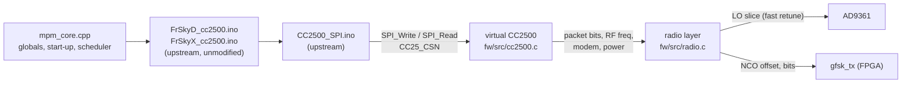

# Multiprotocol on MultiTX

The firmware runs [DIY Multiprotocol](https://github.com/pascallanger/DIY-Multiprotocol-TX-Module)'s
protocol code unmodified, against virtual radio chips. So far that's the FrSky D8 and
FrSky X (D16) protocols on a virtual CC2500.



## Pieces

| Part | Where | |
|---|---|---|
| Multiprotocol sources | [`fw/third_party/multiprotocol`](../fw/third_party/multiprotocol) | git submodule, pinned; not modified |
| Arduino shim | [`fw/src/mpm/mpm_arduino.h`](../fw/src/mpm/mpm_arduino.h) | `millis`/`micros`/delays, `PROGMEM`, `random`, EEPROM in RAM, `SPI_Write`/`SPI_Read`, chip selects |
| Core | [`fw/src/mpm/mpm_core.cpp`](../fw/src/mpm/mpm_core.cpp) | one translation unit that `#include`s the protocol files; replaces `Multiprotocol.ino` (globals, protocol start-up, ID helpers, a µs scheduler) |
| Virtual CC2500 | [`fw/src/cc2500.c`](../fw/src/cc2500.c) | byte-level SPI slave: registers, strobes, status registers, PATABLE, TX FIFO; builds the on-air packet on `STX` |
| Radio layer | [`fw/src/radio.c`](../fw/src/radio.c) | LO slices, NCO offset, modem cache, power, front end |

`Multiprotocol.ino` isn't compiled because it is tied to AVR/STM32 timers, USARTs
and PPM input. `mpm_core.cpp` provides what the protocol files need from it.

### Virtual CC2500

What the chip would do on `STX`, the virtual one does too:

- **Packet assembly:** preamble length from MDMCFG1, sync word per SYNC_MODE (sent twice for the 30/32 modes), fixed/variable/infinite length, CRC-16 (polynomial 0x8005, init 0xFFFF), PN9 whitening.
- **Modem and RF settings:**
  - frequency = FREQ + CHANNR × channel spacing + FSCTRL0 offset;
  - data rate from MDMCFG4/3, deviation from DEVIATN;
  - modulation 2-FSK, GFSK or MSK;
  - power from PATABLE[0], mapped with the data sheet's PA table.
- **After transmitting:** the state follows MCSM1.TXOFF_MODE.
- **Not emulated:**
  - The receiver: RXBYTES stays 0 and RSSI reads −100 dBm, so there's no telemetry yet.
  - OOK, Manchester coding and FEC.
  - Calibration: `SCAL` is accepted, because the AD9361 driver calibrates the real synthesizer.
- **GFSK pulse shape:** BT = 1 is assumed (the data sheet doesn't give it).

### Frequency hopping

The radio runs at 61.44 MSPS. The NCO in `gfsk_tx` reaches ±17.6 MHz from the LO,
so the LO only moves when a channel falls outside the current 35.2 MHz slice. The
slice grid starts at 2403.9 MHz, so two slices cover FrSky's 2404–2474.2 MHz.

- **Slice change:** a synthesizer-only retune (`rf_fast_tune`, same registers as UHD's tune), done in the FDD state with the lock bit polled. The PLL relocks in about 110 µs, and a whole retune takes about 0.3 ms. A real CC2500 spends about 0.8 ms calibrating after `STX`.
- **Channel change inside a slice:** one NCO register write.

No AD9361 fastlock profiles are needed for this.

### Timing

`mpm_poll()` in the main loop calls the protocol callback when its deadline comes.
Each callback returns the delay to the next one, counted from the previous deadline
(like Multiprotocol's `OCR1A += next_callback`), so timing doesn't drift. Measured
over 10 s: no callback more than 100 µs late, worst 12 µs. Console output to the
UART is buffered so it can't stall the protocol.

## Checked without a receiver

`tools/frsky_check.py` runs a protocol, captures single packets on RX2 (TX/RX →
cable + 30 dB attenuator → RX2) and decodes them like a CC2500. For each packet it
checks four things:

- the carrier offset;
- the sync word;
- the CRC: the CC2500 CRC for D8, FrSky's own for D16;
- the channel, which must be in the protocol's hop table.

To fit a packet into one capture it runs at 2–3 MSPS, where the slices are only
1.6–2.4 MHz wide and the LO retunes on nearly every hop.

| Mode | Result |
|---|---|
| FrSky D16, normal | 15/15 packets: CRC ok, channel in hop table, offset exact |
| FrSky D8, normal | 15/15 |
| FrSky D16 / D8, bind | 4/4 each (channel 0, bind packets) |

## Testing with a FrSky receiver

The firmware has no handset input yet, so channels are set from the console.

1. Connect antennas to TX/RX (channel 1) and to the receiver. Bind power is
   −30 dBm, as on a real Multiprotocol module, so keep them within a metre or so.
2. Load the bitstream and firmware, then start the protocol in bind mode:
   ```
   mpm start frskyd 0 0 0 bind      # D8 receivers (D4R-II, D8R, ...)
   mpm start frskyx 0 0 0 bind      # D16 FCC receivers (X4R, XM+, R-XSR ...)
   mpm start frskyx 2 0 0 bind      # D16 LBT (EU) firmware
   ```
   Arguments: protocol, sub-protocol, RX number (model match), option
   (frequency fine tune, FSCTRL0), `bind`.
3. Power the receiver with its bind button held. When its LED shows it has bound,
   run `mpm binddone`, then power-cycle the receiver.
4. Restart without `bind` (`mpm stop`, `mpm start frskyd`). The receiver should
   show a solid link. Move a servo with `mpm ch 1 1844` (channels 1..16, values
   0..2047, centre 1024, ±100% = 204/1844).
5. `mpm status` shows packet and retune counters. If the receiver doesn't lock,
   try a small frequency offset, for example `mpm start frskyd 0 0 -20` (the
   CC2500's FSCTRL0 fine tune, about 1.6 kHz per step). Different CC2500 crystals
   need different values.

The TX ID is fixed (`0x4D545831`, "MTX1") because the board has no non-volatile
storage for it, so a bound receiver stays bound across reboots. `mpm id HEX`
changes it. Output power isn't calibrated: the AD9361 attenuator is set from
PATABLE assuming about +3 dBm at 0 dB attenuation.

## Next

- Handset input: the Multiprotocol serial protocol (EdgeTX/OpenTX "Multi" module)
  on CN2's UART or over USB.
- The receive path, for D8/D16 telemetry and the protocols that need replies.
- The A7105 for FlySky AFHDS 2A.
