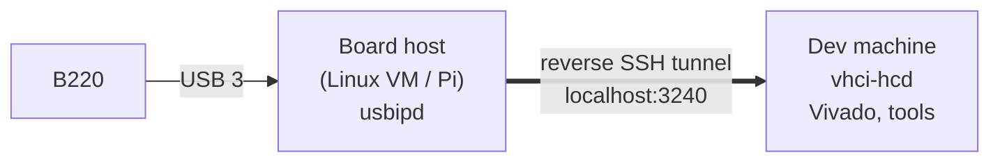

# Working with the board on another machine (USB/IP)

The development machine (with Vivado) and the machine the board is plugged into
don't have to be the same. The board is exported with Linux USB/IP from a small
Linux box or VM next to it, through an SSH tunnel that the board side opens.



- The board host **opens the tunnel outwards**, so nothing on it is reachable from
  the network. The tunnel key can only forward port 3240 and gets no shell.
- The FX3 drops off USB and comes back each time UHD loads its firmware. A service on
  each side re-shares and re-attaches it automatically.

## Setup

**Dev machine** (once):

```bash
sudo remote_usb/vega_setup.sh       # vhci-hcd at boot + usbip-autoattach.service
```

**Board host** (once). Pass the board to the VM first: in VirtualBox add a USB 3
filter for `2500:0020`; in VMware set the device to always connect to the VM. Hyper-V
can't pass USB through, so use `usbipd-win` on Windows instead. Then:

```bash
sudo ./vm_setup.sh <dev-host> <dev-user>   # usbipd, auto-bind, tunnel service
```

It asks for the dev machine's password once, to install the restricted tunnel key.

## Loading bitstreams: always on the board host

UHD sends a bitstream as about 11,000 512-byte control transfers, and over USB/IP
each one waits a full network round trip (170–400 ms in our setup). A 5 MB image
would take over half an hour through the tunnel. So the board host loads it locally:

```bash
sudo ./vm_load_fpga.sh /opt/libresdr/images/<bitstream>.bin
```

The script takes the board back from the tunnel, loads the FX3 firmware and the
bitstream locally (seconds), and shares the board again. For UHD images
(the reference design), opening the board from the dev machine with the identical
file then skips the reload, because UHD compares content hashes.

## What's fast and what's slow over the tunnel

| Operation | Speed |
|---|---|
| Debug-bridge register access | ~0.2–0.4 s per round trip |
| Bulk read/write through the bridge | ~15 KB/s (4 KB per round trip) |
| Full UHD probe (AD9361 init) | ~7 min |
| FPGA load | don't (see above) |

Batch bridge commands with `Bridge.transact()` to save round trips.
